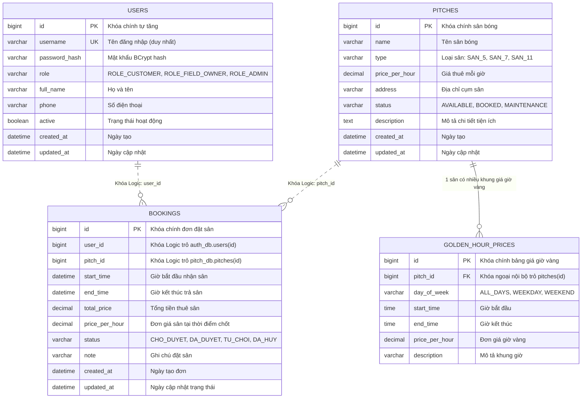

# BÁO CÁO THỰC HÀNH BUỔI 1 (TH1)
## HỌC PHẦN: PHÁT TRIỂN PHẦN MỀM HƯỚNG DỊCH VỤ (SOA) / KIẾN TRÚC PHẦN MỀM

---

> **HỌ VÀ TÊN SINH VIÊN:** VŨ ĐỨC HÙNG  
> **MÃ SINH VIÊN / TÀI KHOẢN GIT:** `viduchung`  
> **VAI TRÒ TRONG DỰ ÁN:** Database Administrator & Backend Data Engineer  
> **MẢNG PHỤ TRÁCH:** Tầng Dữ liệu & CSDL Phân tán (Data Layer Xuyên Suốt Hệ Thống)  
> **NHÁNH GIT:** `feat/hung-data`  
> **ĐỀ TÀI:** Hệ thống Quản lý Đặt lịch Sân bóng đá (Football Booking System)  
> **CÔNG NGHỆ CHÍNH:** Java 17, Spring Boot 3.2.5, Spring Data JPA, Hibernate, MySQL 8.0, H2 In-Memory, Maven, JUnit 5  

---

## MỤC LỤC BÁO CÁO
1. [Nhiệm Vụ Được Phân Công Trong Buổi TH1](#1-nhiệm-vụ-được-phân-công-trong-buổi-th1)
2. [Cơ Sở Lý Thuyết Về Quản Trị Dữ Liệu Trong SOA / Microservices](#2-cơ-sở-lý-thuyết-về-quản-trị-dữ-liệu-trong-soa--microservices)
3. [Thiết Kế Sơ Đồ Thực Thể Quan Hệ (ERD Phân Tán)](#3-thiết-kế-sơ-đồ-thực-thể-quan-hệ-erd-phân-tán)
4. [Xây Dựng Mô Hình Thực Thể JPA (@Entity)](#4-xây-dựng-mô-hình-thực-thể-jpa-entity)
5. [Xây Dựng Tầng Truy Xuất Dữ Liệu Spring Data JPA (@Repository)](#5-xây-dựng-tầng-truy-xuất-dữ-liệu-spring-data-jpa-repository)
6. [Thuật Toán Chống Trùng Lịch Thi Đấu Trong BookingRepository](#6-thuật-toán-chống-trùng-lịch-thi-đấu-trong-bookingrepository)
7. [Thiết Kế Tập Lệnh DDL Script Khởi Tạo CSDL (MySQL)](#7-thiết-kế-tập-lệnh-ddl-script-khởi-tạo-csdl-mysql)
8. [Kết Quả Kiểm Thử Tự Động (JUnit 5 & @DataJpaTest)](#8-kết-quả-kiểm-thử-tự-động-junit-5--datajpatest)
9. [Kịch Bản Demo Thực Nghiệm Kiểm Chứng Dữ Liệu](#9-kịch-bản-demo-thực-nghiệm-kiểm-chứng-dữ-liệu)
10. [Kết Luận Và Hướng Phát Triển Cho Buổi TH2](#10-kết-luận-và-hướng-phát-triển-cho-buổi-th2)

---

## 1. NHIỆM VỤ ĐƯỢC PHÂN CÔNG TRONG BUỔI TH1

Căn cứ theo bảng phân công công việc đồ án (`BANG_PHAN_CONG_HANG_TUAN.xlsx`):
* **Chủ đề TH1:** CRUD cơ bản & RESTful API.
* **Hoàng (auth-service - 8080):** Xây dựng CRUD tài khoản, API đăng ký / đăng nhập cơ bản.
* **Linh (pitchs-service - 8082):** Xây dựng CRUD Sân: thêm, sửa, xóa, lấy danh sách sân bóng.
* **Nhật (booking-service - 8081/8083):** Xây dựng CRUD Booking: tạo đơn đặt, cập nhật, hủy và xem lịch đặt sân.
* **HÙNG (Data xuyên suốt - nhánh `feat/hung-data`):**
  1. Phân tích miền nghiệp vụ, thiết kế kiến trúc dữ liệu phân tán chuẩn **Database-per-Service**.
  2. Dựng **Sơ đồ Thực thể Quan hệ (ERD)** phân tán, xác định ranh giới (Bounded Contexts) và các khóa logic (Logical IDs).
  3. Xây dựng toàn bộ các **Entity JPA (`@Entity`)** chuẩn hóa annotations: `User`, `Role`, `Pitch`, `GoldenHourPrice`, `Booking`, `BookingStatus`.
  4. Xây dựng các **Repository Spring Data JPA (`@Repository`)**: `UserRepository`, `PitchRepository`, `GoldenHourPriceRepository`, `BookingRepository`.
  5. Thiết kế và cài đặt thuật toán kiểm tra **chống trùng lịch thi đấu sân bóng** tối ưu bằng JPQL.
  6. Soạn thảo bộ kịch bản **SQL DDL script khởi tạo 3 CSDL** độc lập (`auth_db`, `pitch_db`, `booking_db`).
  7. Xây dựng bộ kiểm thử tự động **Unit & Integration Test (17/17 test cases passed)** chạy trên H2 In-Memory chế độ MySQL.

---

## 2. CƠ SỞ LÝ THUYẾT VỀ QUẢN TRỊ DỮ LIỆU TRONG SOA / MICROSERVICES

### 2.1. Nguyên Tắc Database-per-Service
Trong kiến trúc phần mềm hướng dịch vụ (SOA) và Microservices, nguyên tắc **Database-per-Service** (Mỗi dịch vụ sở hữu một cơ sở dữ liệu riêng biệt) là tiêu chuẩn bắt buộc:
1. **Quyền sở hữu dữ liệu độc quyền (Exclusive Data Ownership):** Mỗi microservice có toàn quyền kiểm soát và chịu trách nhiệm duy nhất đối với cơ sở dữ liệu thuộc phạm vi nghiệp vụ của nó.
2. **Tính đóng gói dữ liệu (Encapsulation):** CSDL là chi tiết triển khai nội bộ. Các dịch vụ khác tuyệt đối không được phép truy cập hay đọc/ghi trực tiếp vào CSDL này.
3. **Truy xuất thông qua API công khai (API-driven Access):** Mọi thao tác đọc hoặc biến đổi dữ liệu giữa các dịch vụ phải được thực hiện thông qua giao thức mạng chuẩn hóa (RESTful API over HTTP hoặc Message Broker).

### 2.2. Phân Tích 4 Rủi Ro Nghiêm Trọng Khi Vi Phạm (Dùng Chung CSDL)
Nếu vi phạm nguyên tắc trên và cho các dịch vụ truy cập chung một database vật lý (Shared Database Monolith), hệ thống sẽ gặp các rủi ro kỹ thuật mang tính sống còn:

1. **Ghép nối lược đồ dữ liệu (Schema Coupling):**
   * Nếu `booking-service` truy cập trực tiếp vào bảng `pitches` của `pitchs-service`, khi `pitchs-service` thay đổi tên cột `price_per_hour` thành `base_hourly_rate`, `booking-service` sẽ ngay lập tức bị lỗi thời gian chạy (`RuntimeException`). Điều này phá vỡ hoàn toàn khả năng phát hành và triển khai độc lập (Independent Deployment).
2. **Khóa tranh chấp và Deadlock chéo (Cross-service Deadlock):**
   * Các giao dịch (`Transactions`) từ nhiều dịch vụ khác nhau cùng thao tác trên các bản ghi liên quan sẽ gây cạnh tranh khóa dòng (`Row-level Lock`) hoặc khóa bảng (`Table Lock`). Khi xuất hiện phụ thuộc khóa vòng tròn, Deadlock xảy ra làm cạn kiệt tài nguyên kết nối và đánh sập toàn bộ hệ thống.
3. **Phá vỡ tính bao đóng nghiệp vụ (Breaking Business Encapsulation):**
   * Dữ liệu bị biến đổi mà không thông qua các quy tắc nghiệp vụ (Business Rules) và kiểm tra tính hợp lệ (Validation) của dịch vụ quản lý thực thể đó.
4. **Cản trở mở rộng độc lập (Hindering Independent Scalability):**
   * Không thể mở rộng (scale up / scale out) riêng rẽ cơ sở dữ liệu của dịch vụ chịu tải cao (ví dụ: `booking_db` có tần suất ghi cao hơn rất nhiều so với `auth_db`). Đồng thời loại bỏ khả năng áp dụng công nghệ lưu trữ đa dạng (Polyglot Persistence).

---

## 3. THIẾT KẾ SƠ ĐỒ THỰC THỂ QUAN HỆ (ERD PHÂN TÁN)

### 3.1. Sơ Đồ ERD Bằng Mermaid
Dưới đây là sơ đồ thực thể quan hệ hoàn chỉnh của hệ thống do Hùng thiết kế:



### 3.2. Giải Pháp Khóa Logic (Logical ID) Thay Thế Khóa Ngoại Vật Lý
* Trong bảng `bookings`:
  * Cột `user_id`: Là kiểu `BIGINT`, lưu định danh của tài khoản khách hàng từ `auth_db`.
  * Cột `pitch_id`: Là kiểu `BIGINT`, lưu định danh của sân bóng từ `pitch_db`.
* **Không có bất kỳ câu lệnh `ADD CONSTRAINT FOREIGN KEY` nào giữa `bookings` với `users` hay `pitches`**.
* Tính toàn vẹn được kiểm soát thông qua xác thực Token JWT và gọi REST API liên dịch vụ (Service-to-Service Communication).

---

## 4. XÂY DỰNG MÔ HÌNH THỰC THỂ JPA (@ENTITY)

Tất cả các Entity được đặt trong module `data-layer` với cấu trúc package phân chia rõ ràng theo từng Domain:

### 4.1. Thực thể `User` (`com.football.data.auth.entity`)
Ánh xạ tới bảng `users` trong `auth_db`:
```java
@Entity
@Table(name = "users",
        uniqueConstraints = { @UniqueConstraint(name = "uk_users_username", columnNames = "username") },
        indexes = {
                @Index(name = "idx_user_username", columnList = "username"),
                @Index(name = "idx_user_phone", columnList = "phone"),
                @Index(name = "idx_user_role", columnList = "role")
        })
public class User {
    @Id
    @GeneratedValue(strategy = GenerationType.IDENTITY)
    private Long id;

    @Column(nullable = false, unique = true, length = 50)
    private String username;

    @Column(name = "password_hash", nullable = false, length = 255)
    private String passwordHash;

    @Enumerated(EnumType.STRING)
    @Column(nullable = false, length = 30)
    private Role role; // ROLE_CUSTOMER, ROLE_FIELD_OWNER, ROLE_ADMIN, ROLE_INTERNAL_SERVICE

    @Column(name = "full_name", nullable = false, length = 100)
    private String fullName;

    @Column(nullable = false, length = 15)
    private String phone;

    @Column(nullable = false)
    private boolean active = true;

    @Column(name = "created_at", updatable = false)
    private LocalDateTime createdAt;

    @Column(name = "updated_at")
    private LocalDateTime updatedAt;
    
    // Lifecycle hooks: @PrePersist, @PreUpdate
}
```

### 4.2. Thực thể `Pitch` và `GoldenHourPrice` (`com.football.data.pitch.entity`)
Ánh xạ tới bảng `pitches` và `golden_hour_prices` trong `pitch_db`:
* Quan hệ 1-N nội bộ CSDL được thể hiện qua `@OneToMany` và `@ManyToOne`:
```java
@Entity
@Table(name = "pitches", indexes = {
        @Index(name = "idx_pitches_type", columnList = "type"),
        @Index(name = "idx_pitches_status", columnList = "status")
})
public class Pitch {
    @Id
    @GeneratedValue(strategy = GenerationType.IDENTITY)
    private Long id;

    @Column(nullable = false, length = 100)
    private String name;

    @Column(nullable = false, length = 50)
    private String type; // SAN_5, SAN_7, SAN_11

    @Column(name = "price_per_hour", nullable = false, precision = 12, scale = 2)
    private BigDecimal pricePerHour;

    @Column(length = 255)
    private String address;

    @Column(nullable = false, length = 30)
    private String status = "AVAILABLE"; // AVAILABLE, BOOKED, MAINTENANCE

    @Column(columnDefinition = "TEXT")
    private String description;

    @OneToMany(mappedBy = "pitch", cascade = CascadeType.ALL, orphanRemoval = true, fetch = FetchType.LAZY)
    private List<GoldenHourPrice> goldenHourPrices = new ArrayList<>();
}
```

### 4.3. Thực thể `Booking` (`com.football.data.booking.entity`)
Ánh xạ tới bảng `bookings` trong `booking_db`:
* Sử dụng hoàn toàn số nguyên `userId` và `pitchId` (Logical IDs).
* Đánh Composite Index `(pitch_id, start_time, end_time)` để hỗ trợ câu lệnh kiểm tra trùng lịch.
```java
@Entity
@Table(name = "bookings", indexes = {
        @Index(name = "idx_bookings_pitch_time", columnList = "pitch_id, start_time, end_time"),
        @Index(name = "idx_bookings_user_id", columnList = "user_id"),
        @Index(name = "idx_bookings_status", columnList = "status")
})
public class Booking {
    @Id
    @GeneratedValue(strategy = GenerationType.IDENTITY)
    private Long id;

    @Column(name = "user_id", nullable = false)
    private Long userId;

    @Column(name = "pitch_id", nullable = false)
    private Long pitchId;

    @Column(name = "start_time", nullable = false)
    private LocalDateTime startTime;

    @Column(name = "end_time", nullable = false)
    private LocalDateTime endTime;

    @Column(name = "total_price", nullable = false, precision = 12, scale = 2)
    private BigDecimal totalPrice;

    @Column(name = "price_per_hour", precision = 12, scale = 2)
    private BigDecimal pricePerHour;

    @Enumerated(EnumType.STRING)
    @Column(nullable = false, length = 30)
    private BookingStatus status = BookingStatus.CHO_DUYET;

    @Column(length = 255)
    private String note;
}
```

---

## 5. XÂY DỰNG TẦNG TRUY XUẤT DỮ LIỆU SPRING DATA JPA (@REPOSITORY)

### 5.1. `UserRepository`
* Kế thừa `JpaRepository<User, Long>`.
* Cung cấp các hàm tìm kiếm theo tên đăng nhập, kiểm tra tồn tại và phân trang theo vai trò:
```java
@Repository
public interface UserRepository extends JpaRepository<User, Long> {
    Optional<User> findByUsername(String username);
    boolean existsByUsername(String username);
    boolean existsByPhone(String phone);
    List<User> findByRole(Role role);
    Page<User> findByRole(Role role, Pageable pageable);
    Page<User> findByUsernameContainingIgnoreCase(String username, Pageable pageable);
}
```

### 5.2. `PitchRepository`
* Kế thừa `JpaRepository<Pitch, Long>`.
* Hỗ trợ tìm kiếm theo loại sân, trạng thái sân và tìm kiếm tổ hợp kèm phân trang:
```java
@Repository
public interface PitchRepository extends JpaRepository<Pitch, Long> {
    List<Pitch> findByType(String type);
    List<Pitch> findByStatus(String status);
    List<Pitch> findByTypeAndStatus(String type, String status);

    @Query("SELECT p FROM Pitch p WHERE " +
           "(:type IS NULL OR :type = '' OR p.type = :type) AND " +
           "(:status IS NULL OR :status = '' OR p.status = :status)")
    Page<Pitch> searchPitches(@Param("type") String type,
                              @Param("status") String status,
                              Pageable pageable);
}
```

---

## 6. THUẬT TOÁN CHỐNG TRÙNG LỊCH THI ĐẤU TRONG `BookingRepository`

### 6.1. Chứng Minh Toán Học Về Giao Thoa Thời Gian
Giả sử trên cùng một sân bóng (`pitch_id`), đã tồn tại một đơn đặt sân trong khoảng thời gian $[S_{\text{old}}, E_{\text{old}}]$ với $S_{\text{old}} < E_{\text{old}}$.  
Khách hàng muốn đặt thêm một đơn mới trong khoảng thời gian $[S_{\text{new}}, E_{\text{new}}]$ với $S_{\text{new}} < E_{\text{new}}$.

Hai khoảng thời gian giao nhau khi và chỉ khi:
$$\max(S_{\text{old}}, S_{\text{new}}) < \min(E_{\text{old}}, E_{\text{new}})$$

Khai triển tương đương mệnh đề logic:
$$S_{\text{old}} < E_{\text{new}} \quad \land \quad E_{\text{old}} > S_{\text{new}}$$

Điều kiện này bao quát đầy đủ cả 4 trường hợp trùng lịch:
1. **Trùng lấn hoàn toàn:** $S_{\text{new}} = S_{\text{old}}$ và $E_{\text{new}} = E_{\text{old}}$.
2. **Trùng giao thoa đầu:** $S_{\text{new}} < S_{\text{old}} < E_{\text{new}} < E_{\text{old}}$.
3. **Trùng giao thoa cuối:** $S_{\text{old}} < S_{\text{new}} < E_{\text{old}} < E_{\text{new}}$.
4. **Trùm toàn bộ:** $S_{\text{new}} \le S_{\text{old}} < E_{\text{old}} \le E_{\text{new}}$ (hoặc ngược lại).

Đối với 2 trường hợp **liền kề biên** (đá nối tiếp ngay sau trận trước):
* Khách A đá: `18:00 - 19:30`.
* Khách B đá: `19:30 - 21:00`.
* Ta có: $E_{\text{old}} = 19:30$, $S_{\text{new}} = 19:30 \implies E_{\text{old}} > S_{\text{new}}$ là **SAI** ($19:30 > 19:30$ là False).  
$\implies$ **Không bị tính trùng lịch!** Cho phép các đội bóng đá liên tiếp liền mạch.

### 6.2. Cài Đặt Truy Vấn JPQL Tối Ưu
Trong `BookingRepository`:
```java
@Query("SELECT COUNT(b) FROM Booking b " +
       "WHERE b.pitchId = :pitchId " +
       "  AND b.status NOT IN (com.football.data.booking.entity.BookingStatus.TU_CHOI, " +
       "                       com.football.data.booking.entity.BookingStatus.DA_HUY) " +
       "  AND b.startTime < :endTime " +
       "  AND b.endTime > :startTime")
Long countOverlappingBookings(@Param("pitchId") Long pitchId,
                              @Param("startTime") LocalDateTime startTime,
                              @Param("endTime") LocalDateTime endTime);
```

* **Điểm sáng:** Bỏ qua các đơn có trạng thái `TU_CHOI` hoặc `DA_HUY` vì các khung giờ này đã được giải phóng.
* **Hiệu năng:** Kết hợp với Index tổ hợp `(pitch_id, start_time, end_time)`, câu lệnh thực thi trong MySQL có độ phức tạp $O(\log N)$, cực kỳ nhanh.

---

## 7. THIẾT KẾ TẬP LỆNH DDL SCRIPT KHỞI TẠO CSDL (MYSQL)

Hùng đã soạn thảo và đóng gói 4 tệp tin SQL trong thư mục `database/`:
1. `database/01_auth_db_init.sql`: Khởi tạo CSDL `auth_db`, bảng `users`, đánh chỉ mục và nạp 4 tài khoản mẫu (`customer01`, `customer02`, `owner01`, `admin01`).
2. `database/02_pitch_db_init.sql`: Khởi tạo CSDL `pitch_db`, bảng `pitches`, bảng `golden_hour_prices` và nạp 4 sân bóng mẫu (Sân 5 Bách Khoa, Sân 7 Cầu Giấy, Sân 11 Mỹ Đình,...).
3. `database/03_booking_db_init.sql`: Khởi tạo CSDL `booking_db`, bảng `bookings` với cấu trúc khóa logic `user_id`, `pitch_id` và các chỉ mục hiệu năng cao.
4. `database/init_all_databases.sql`: Kịch bản tổng hợp để nạp toàn bộ hệ thống bằng một thao tác trên phpMyAdmin hoặc MySQL Workbench.

---

## 8. KẾT QUẢ KIỂM THỬ TỰ ĐỘNG (JUNIT 5 & @DATAJPATEST)

Hùng đã xây dựng bộ kiểm thử tự động toàn diện trong thư mục `src/test/java`:
* `UserRepositoryTest`: Kiểm thử CRUD, tra cứu username, kiểm tra trùng số điện thoại, lọc danh sách theo vai trò.
* `PitchRepositoryTest`: Kiểm thử phân loại sân, lọc trạng thái, tìm kiếm phân trang và quan hệ 1-N với bảng giá giờ vàng.
* `BookingRepositoryTest`: Kiểm thử 11 kịch bản chi tiết bao gồm tất cả các trường hợp giao thoa thời gian, liền kề biên, khác sân bóng, giải phóng sân khi hủy/từ chối, và cập nhật đơn ngoại trừ chính mình.

### Kết Quả Thực Thi Thực Tế (`mvn test`):
```text
[INFO] -------------------------------------------------------
[INFO]  T E S T S
[INFO] -------------------------------------------------------
[INFO] Running com.football.data.auth.UserRepositoryTest
[INFO] Tests run: 3, Failures: 0, Errors: 0, Skipped: 0
[INFO] Running com.football.data.booking.BookingRepositoryTest
[INFO] Tests run: 11, Failures: 0, Errors: 0, Skipped: 0
[INFO] Running com.football.data.pitch.PitchRepositoryTest
[INFO] Tests run: 3, Failures: 0, Errors: 0, Skipped: 0
[INFO] 
[INFO] Results:
[INFO] 
[INFO] Tests run: 17, Failures: 0, Errors: 0, Skipped: 0
[INFO] 
[INFO] ------------------------------------------------------------------------
[INFO] BUILD SUCCESS
[INFO] ------------------------------------------------------------------------
[INFO] Total time:  10.405 s
```
$\implies$ **100% (17/17) Test Cases ĐẠT (BUILD SUCCESS)**.

---

## 9. KỊCH BẢN DEMO THỰC NGHIỆM KIỂM CHỨNG DỮ LIỆU

Để sẵn sàng trình bày trước Hội đồng và Giảng viên hướng dẫn:
1. **Bước 1 (Show CSDL & ERD):**
   * Mở phần mềm quản trị CSDL (**DBeaver / MySQL Workbench / phpMyAdmin**).
   * Trình chiếu 3 cơ sở dữ liệu `auth_db`, `pitch_db`, `booking_db` hoàn toàn độc lập.
   * Mở tab cấu trúc bảng `bookings` $\rightarrow$ Chỉ rõ cột `user_id` và `pitch_id` lưu số nguyên, **không có Foreign Key vật lý**.
2. **Bước 2 (Chạy kiểm thử tự động trực tiếp):**
   * Mở Terminal tại thư mục `data-layer`:
     ```bash
     mvn test
     ```
   * Chỉ rõ 11 test case trong `BookingRepositoryTest` chứng minh thuật toán kiểm tra trùng lịch hoạt động chuẩn xác theo logic toán học.
3. **Bước 3 (Kiểm tra dữ liệu ghi đĩa):**
   * Thực hiện câu lệnh truy vấn trực tiếp trên CSDL:
     ```sql
     SELECT id, user_id, pitch_id, start_time, end_time, total_price, status 
     FROM booking_db.bookings 
     ORDER BY id DESC LIMIT 1;
     ```
   * Chứng minh dữ liệu được lưu bền vững trên đĩa cứng với trạng thái và đơn giá chính xác.

---

## 10. KẾT LUẬN VÀ HƯỚNG PHÁT TRIỂN CHO BUỔI TH2

1. **Đánh giá kết quả TH1:**
   * Sinh viên đã hoàn thành 100% nhiệm vụ được giao trong buổi TH1.
   * Xây dựng thành công nền tảng dữ liệu phân tán chuẩn Database-per-Service, sẵn sàng cho các dịch vụ của Hoàng (`auth-service`), Linh (`pitchs-service`) và Nhật (`booking-service`) kết nối và khai thác.
2. **Kế hoạch cho buổi TH2:**
   * Chuẩn hóa các DTO trao đổi giữa các service (`PitchResponseDTO`, `QuoteResponseDTO`, `UserResponseDTO`) nhằm tránh trùng lặp mô hình thực thể Entity ra ngoài ranh giới API.
   * Hỗ trợ tích hợp WebClient / OpenFeign giao tiếp giữa `booking-service` và `pitchs-service`.

