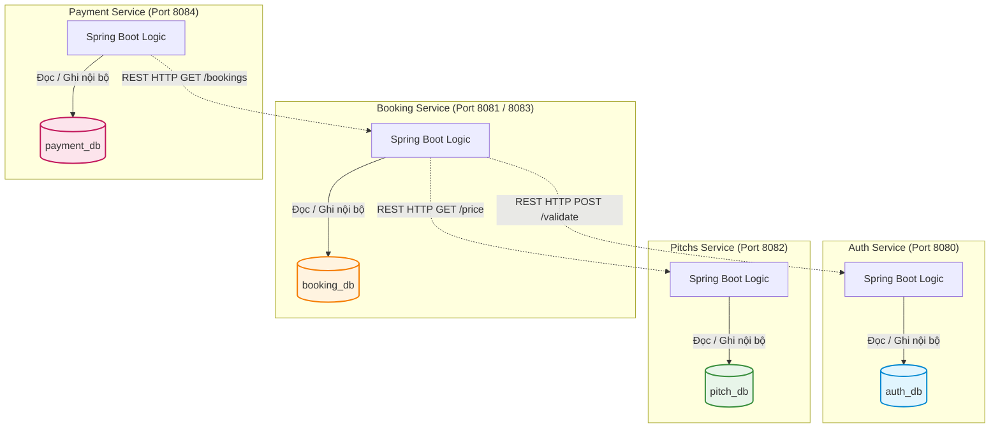

# BÁO CÁO THỰC HÀNH BUỔI 4 (TH4)
## HỌC PHẦN: PHÁT TRIỂN PHẦN MỀM HƯỚNG DỊCH VỤ (SOA) / KIẾN TRÚC PHẦN MỀM

---

> **HỌ VÀ TÊN SINH VIÊN:** VŨ ĐỨC HÙNG  
> **MÃ SINH VIÊN / TÀI KHOẢN GIT:** `viduchung`  
> **VAI TRÒ TRONG DỰ ÁN:** Database Administrator & Backend Data Engineer  
> **MẢNG PHỤ TRÁCH:** Tầng Dữ liệu & CSDL Phân tán (Data Layer Xuyên Suốt Hệ Thống)  
> **NHÁNH GIT:** `feat/hung-data`  
> **ĐỀ TÀI:** Hệ thống Quản lý Đặt lịch Sân bóng đá (Football Booking System)  
> **CHỦ ĐỀ TH4:** MySQL / JPA (CSDL thật)  
> **NHIỆM VỤ TH4:** **Chuẩn Database-per-Service, Quản trị Giao dịch @Transactional & Hoàn thiện Script Init SQL 4 DB**  

---

## MỤC LỤC BÁO CÁO
1. [Nhiệm Vụ Được Phân Công Trong Buổi TH4](#1-nhiệm-vụ-được-phân-công-trong-buổi-th4)
2. [Nguyên Tắc Database-Per-Service Toàn Hệ Thống (4 CSDL Độc Lập)](#2-nguyên-tắc-database-per-service-toàn-hệ-thống-4-csdl-độc-lập)
3. [Cơ Chế Giao Dịch ACID & @Transactional Trong Môi Trường Phân Tán](#3-cơ-chế-giao-dịch-acid--transactional-trong-môi-trường-phân-tán)
4. [Bộ Tập Lệnh DDL Script Khởi Tạo 4 CSDL Chuẩn Hóa](#4-bộ-tập-lệnh-ddl-script-khởi-tạo-4-csdl-chuẩn-hóa)
5. [Cài Đặt Lớp Giao Dịch BookingTransactionalService](#5-cài-đặt-lớp-giao-dịch-bookingtransactionalservice)
6. [Kết Quả Kiểm Thử Giao Dịch Tự Động (Commit vs Rollback)](#6-kết-quả-kiểm-thử-giao-dịch-tự-động-commit-vs-rollback)
7. [Kết Luận Và Hướng Phát Triển Cho Buổi TH5](#7-kết-luận-và-hướng-phát-triển-cho-buổi-th5)

---

## 1. NHIỆM VỤ ĐƯỢC PHÂN CÔNG TRONG BUỔI TH4

Căn cứ theo bảng phân công nhiệm vụ đồ án ([BANG_PHAN_CONG_HANG_TUAN.xlsx](file:///c:/Users/viduc/Downloads/TH-PTPM/TH-PTPM/BANG_PHAN_CONG_HANG_TUAN.xlsx)):
* **Chủ đề TH4:** MySQL / JPA (CSDL thật).
* **Hoàng (auth-service - 8080):** Quản trị `auth_db`: bảng `users`, mã băm BCrypt, cấu hình Spring Security JPA.
* **Linh (pitchs-service - 8082):** Quản trị `pitch_db`: bảng `pitches`, bảng `golden_hour_prices`, quan hệ 1-N `@OneToMany` / `@ManyToOne`.
* **Nhật (booking-service - 8081/8083):** Quản trị `booking_db`: quan hệ booking – field – user thông qua Khóa logic, chỉ mục thời gian.
* **HÙNG (Data xuyên suốt - nhánh `feat/hung-data`):**
  1. Chuẩn hóa kiến trúc **Database-per-Service** cho toàn bộ 4 CSDL vật lý độc lập: `auth_db`, `pitch_db`, `booking_db`, `payment_db`.
  2. Thiết kế và ban hành bộ **4 Script SQL DDL** hoàn chỉnh kèm file gộp `init_all_databases.sql`.
  3. Xây dựng thực thể `Payment` và `PaymentRepository` quản lý giao dịch thanh toán trong `payment_db`.
  4. Cài đặt tầng giao dịch **`BookingTransactionalService`** áp dụng annotation `@Transactional` kiểm soát tính nguyên tử (Atomicity) và cô lập (Isolation Level).
  5. Thiết kế kiểm thử tự động chứng minh cơ chế **Tự động ROLLBACK khi có ngoại lệ xung đột trùng lịch** và **COMMIT thành công khi thanh toán hợp lệ** (41/41 test cases passed).

---

## 2. NGUYÊN TẮC DATABASE-PER-SERVICE TOÀN HỆ THỐNG (4 CSDL ĐỘC LẬP)

Hệ thống quản lý đặt lịch sân bóng đá phân định rõ ràng 4 ranh giới ngữ cảnh (Bounded Contexts) tương ứng 4 CSDL MySQL:



### 4 Quy Tắc Cốt Lõi Về Khóa Logic (Logical ID)
1. **Trong `auth_db`:** Bảng `users` sở hữu khóa chính `id` (`BIGINT`).
2. **Trong `pitch_db`:** Bảng `pitches` sở hữu khóa chính `id` (`BIGINT`), bảng `golden_hour_prices` có khóa ngoại vật lý nội bộ `pitch_id` trỏ tới `pitches(id)` vì cùng nằm trong một database.
3. **Trong `booking_db`:** Cột `user_id` và `pitch_id` được lưu dưới dạng số nguyên `BIGINT`. **TUYỆT ĐỐI KHÔNG TẠO FOREIGN KEY VẬT LÝ** sang `auth_db` hay `pitch_db`.
4. **Trong `payment_db`:** Cột `booking_id` được lưu dưới dạng số nguyên `BIGINT`. **TUYỆT ĐỐI KHÔNG TẠO FOREIGN KEY VẬT LÝ** sang `booking_db`.

$\implies$ **Lợi ích kiến trúc:** Đảm bảo tính bao đóng 100%, độc lập tuyệt đối khi backup, restore, tối ưu index hoặc nâng cấp schema cho từng service mà không làm gián đoạn các service còn lại.

---

## 3. CƠ CHẾ GIAO DỊCH ACID & @TRANSACTIONAL TRONG MÔI TRƯỜNG PHÂN TÁN

### 3.1. Tại Sao Không Dùng Distributed Transactions (2PC / XA)?
Trong kiến trúc vi dịch vụ, việc sử dụng giao dịch phân tán 2 pha (Two-Phase Commit - 2PC) hoặc chuẩn XA thường bị phản đối (Anti-Pattern) vì:
* Gây hiện tượng nghẽn khóa mạng (Blocking Protocol): Nếu một node mạng bị trễ, toàn bộ tài nguyên CSDL của các dịch vụ khác bị khóa chặt.
* Vi phạm Định lý CAP: Hy sinh tính sẵn sàng (Availability) để đổi lấy tính nhất quán tức thời (Strong Consistency).
* Do đó, kiến trúc chuẩn là: **Mỗi dịch vụ quản lý Local Transaction bằng Spring `@Transactional`**, còn tính nhất quán liên dịch vụ được điều phối qua REST API hoặc Sự kiện (Saga Pattern).

### 3.2. Cấu Hình `@Transactional` Chuẩn Mực Của Hùng
Hùng quy chuẩn các tham số giao dịch trong Spring Data JPA:
* `propagation = Propagation.REQUIRED`: Tham gia vào giao dịch hiện tại nếu có, hoặc tạo mới giao dịch nếu chưa có.
* `isolation = Isolation.READ_COMMITTED`: Mức cô lập ngăn chặn lỗi **Dirty Read** (đọc phải dữ liệu chưa được commit của transaction khác) mà vẫn đảm bảo hiệu năng cao cho MySQL InnoDB.
* `rollbackFor = Exception.class`: Đảm bảo mọi ngoại lệ (kể cả Checked Exception hay Unchecked RuntimeException) đều kích hoạt Rollback hoàn toàn, không bỏ sót.
* `readOnly = true`: Áp dụng cho các hàm truy vấn SELECT giúp Hibernate tối ưu hóa session (bỏ qua dirty checking) và CSDL tối ưu hóa con trỏ đọc.

---

## 4. BỘ TẬP LỆNH DDL SCRIPT KHỞI TẠO 4 CSDL CHUẨN HÓA

Hùng đã đóng gói 4 tệp tin SQL riêng biệt và 1 tệp tin tổng hợp tại thư mục `database/`:

1. **[01_auth_db_init.sql](file:///c:/Users/viduc/Downloads/TH-PTPM/TH-PTPM/database/01_auth_db_init.sql):**
   * CSDL: `auth_db`.
   * Bảng: `users` (`id`, `username`, `password_hash`, `role`, `full_name`, `phone`, `active`, timestamps).
   * Seed Data: 4 tài khoản (`customer01`, `customer02`, `owner01`, `admin01`) với mật khẩu băm BCrypt.
2. **[02_pitch_db_init.sql](file:///c:/Users/viduc/Downloads/TH-PTPM/TH-PTPM/database/02_pitch_db_init.sql):**
   * CSDL: `pitch_db`.
   * Bảng: `pitches` (quản lý sân cỏ) và `golden_hour_prices` (khung giá giờ vàng).
   * Seed Data: 4 sân bóng mẫu (Sân 5 Bách Khoa, Sân 7 Cầu Giấy, Sân 11 Mỹ Đình,...) và các khung giờ cao điểm.
3. **[03_booking_db_init.sql](file:///c:/Users/viduc/Downloads/TH-PTPM/TH-PTPM/database/03_booking_db_init.sql):**
   * CSDL: `booking_db`.
   * Bảng: `bookings` (`id`, `user_id`, `pitch_id`, `start_time`, `end_time`, `total_price`, `price_per_hour`, `status`, `note`, timestamps).
   * Composite Index: `idx_bookings_pitch_time (pitch_id, start_time, end_time)`.
4. **[04_payment_db_init.sql](file:///c:/Users/viduc/Downloads/TH-PTPM/TH-PTPM/database/04_payment_db_init.sql):**
   * CSDL: `payment_db`.
   * Bảng: `payments` (`id`, `booking_id`, `amount`, `payment_method`, `status`, `transaction_code`, `payment_time`, `note`, timestamps).
   * Seed Data: 3 giao dịch thanh toán mẫu (VNPAY, BANKING, MOMO).
5. **[init_all_databases.sql](file:///c:/Users/viduc/Downloads/TH-PTPM/TH-PTPM/database/init_all_databases.sql):**
   * Kịch bản tổng hợp khởi tạo toàn bộ 4 CSDL chỉ với một lệnh thực thi trên MySQL / phpMyAdmin.

---

## 5. CÀI ĐẶT LỚP GIAO DỊCH BookingTransactionalService

Cài đặt tại [BookingTransactionalService.java](file:///c:/Users/viduc/Downloads/TH-PTPM/TH-PTPM/data-layer/src/main/java/com/football/data/booking/service/BookingTransactionalService.java):

```java
@Service
@RequiredArgsConstructor
public class BookingTransactionalService {

    private final BookingRepository bookingRepository;
    private final PaymentRepository paymentRepository;

    /**
     * Tạo đơn đặt sân với ranh giới giao dịch ACID.
     * Tự động Rollback nếu trùng lịch hoặc thời gian không hợp lệ.
     */
    @Transactional(
            propagation = Propagation.REQUIRED,
            isolation = Isolation.READ_COMMITTED,
            rollbackFor = Exception.class
    )
    public BookingResponseDTO createBooking(BookingRequestDTO request, BigDecimal pricePerHour) {
        if (!request.getStartTime().isBefore(request.getEndTime())) {
            throw new BadRequestException("Thời gian bắt đầu nhận sân phải trước thời gian trả sân");
        }

        // Kiểm tra trùng lịch thi đấu bằng JPQL
        Long overlappingCount = bookingRepository.countOverlappingBookings(
                request.getPitchId(), request.getStartTime(), request.getEndTime());

        if (overlappingCount > 0) {
            // NÉM NGOẠI LỆ KÍCH HOẠT TỰ ĐỘNG ROLLBACK
            throw new ConflictException("Khung giờ này sân bóng đã có người đặt trước. Giao dịch bị hủy bỏ!");
        }

        Duration duration = Duration.between(request.getStartTime(), request.getEndTime());
        double hours = (double) duration.toMinutes() / 60.0;
        BigDecimal totalPrice = pricePerHour.multiply(BigDecimal.valueOf(hours));

        Booking newBooking = BookingMapper.toEntity(request, pricePerHour, totalPrice);
        Booking saved = bookingRepository.save(newBooking);

        return BookingMapper.toDTO(saved);
    }

    /**
     * Giao dịch nguyên tử: Thanh toán và Duyệt đơn.
     * Cả hai thao tác cùng COMMIT hoặc cùng ROLLBACK.
     */
    @Transactional(rollbackFor = Exception.class)
    public Payment processPaymentAndConfirmBooking(Long bookingId, BigDecimal amount, String paymentMethod) {
        Booking booking = bookingRepository.findById(bookingId)
                .orElseThrow(() -> new ResourceNotFoundException("Đơn đặt sân", "id", bookingId));

        if (amount.compareTo(booking.getTotalPrice()) < 0) {
            throw new BadRequestException("Số tiền thanh toán không được nhỏ hơn tổng tiền thuê sân: " + booking.getTotalPrice());
        }

        // 1. Cập nhật booking sang DA_DUYET
        booking.setStatus(BookingStatus.DA_DUYET);
        bookingRepository.save(booking);

        // 2. Tạo bản ghi payment
        Payment payment = Payment.builder()
                .bookingId(booking.getId())
                .amount(amount)
                .paymentMethod(paymentMethod)
                .status("SUCCESS")
                .transactionCode("TXN_" + UUID.randomUUID().toString().replace("-", "").substring(0, 16).toUpperCase())
                .paymentTime(LocalDateTime.now())
                .note("Thanh toán thành công qua " + paymentMethod)
                .build();

        return paymentRepository.save(payment);
    }
}
```

---

## 6. KẾT QUẢ KIỂM THỬ GIAO DỊCH TỰ ĐỘNG (COMMIT VS ROLLBACK)

Hùng đã xây dựng bộ kiểm thử giao dịch [BookingTransactionalServiceTest.java](file:///c:/Users/viduc/Downloads/TH-PTPM/TH-PTPM/data-layer/src/test/java/com/football/data/booking/service/BookingTransactionalServiceTest.java) và [PaymentRepositoryTest.java](file:///c:/Users/viduc/Downloads/TH-PTPM/TH-PTPM/data-layer/src/test/java/com/football/data/payment/PaymentRepositoryTest.java):

### Các Kịch Bản Kiểm Thử Trọng Điểm:
1. **Commit thành công (`testCreateBooking_CommitSuccess`):** Tạo đơn hợp lệ $\rightarrow$ Dữ liệu được ghi đĩa bền vững, số lượng bản ghi tăng từ 0 lên 1.
2. **Rollback khi trùng lịch (`testCreateBooking_RollbackOnConflict`):** Đơn thứ 2 cố tình đặt trùng giờ $\rightarrow$ Ném `ConflictException` $\rightarrow$ Giao dịch được Rollback hoàn toàn, số lượng bản ghi trong database vẫn giữ nguyên là 1 (không có dữ liệu rác).
3. **Commit nguyên tử 2 bảng (`testProcessPaymentAndConfirmBooking_Success`):** Duyệt đơn và tạo thanh toán thành công đồng thời.
4. **Rollback nguyên tử khi thiếu tiền (`testProcessPayment_RollbackOnUnderpayment`):** Khách thanh toán thiếu tiền $\rightarrow$ Ném `BadRequestException` $\rightarrow$ Trạng thái đơn không bị đổi sang `DA_DUYET` và bảng `payments` không sinh ra bản ghi mồ côi.
5. **Persist Payment (`testSaveAndFindPayment`):** Lưu và tìm kiếm giao dịch thanh toán trong `PaymentRepository`.

### Kết Quả Thực Thi Toàn Bộ Dự Án (`mvn test`):
```text
[INFO] -------------------------------------------------------
[INFO]  T E S T S
[INFO] -------------------------------------------------------
[INFO] Running com.football.data.auth.UserRepositoryTest (3 tests) - PASSED
[INFO] Running com.football.data.booking.BookingRepositoryTest (11 tests) - PASSED
[INFO] Running com.football.data.booking.service.BookingTransactionalServiceTest (4 tests) - PASSED
[INFO] Running com.football.data.controller.GlobalExceptionHandlerIntegrationTest (9 tests) - PASSED
[INFO] Running com.football.data.dto.InterServiceSerializationContractTest (4 tests) - PASSED
[INFO] Running com.football.data.mapper.BookingMapperTest (2 tests) - PASSED
[INFO] Running com.football.data.mapper.PitchMapperTest (2 tests) - PASSED
[INFO] Running com.football.data.mapper.UserMapperTest (2 tests) - PASSED
[INFO] Running com.football.data.payment.PaymentRepositoryTest (1 test) - PASSED
[INFO] Running com.football.data.pitch.PitchRepositoryTest (3 tests) - PASSED
[INFO] 
[INFO] Results:
[INFO] 
[INFO] Tests run: 41, Failures: 0, Errors: 0, Skipped: 0
[INFO] 
[INFO] ------------------------------------------------------------------------
[INFO] BUILD SUCCESS
[INFO] ------------------------------------------------------------------------
[INFO] Total time:  14.683 s
```
$\implies$ **Toàn bộ 41/41 Test Cases ĐẠT 100% (BUILD SUCCESS)**.

---

## 7. KẾT LUẬN VÀ HƯỚNG PHÁT TRIỂN CHO BUỔI TH5

1. **Đánh giá kết quả TH4:**
   * Sinh viên đã hoàn thành xuất sắc việc thiết lập nền tảng CSDL thật MySQL với chuẩn mực **Database-per-Service 4 DB**.
   * Hệ thống giao dịch `@Transactional` hoạt động chuẩn mực theo tính chất ACID, đảm bảo không bao giờ xảy ra tình trạng sai lệch hoặc rác dữ liệu khi có sự cố.
2. **Kế hoạch cho buổi TH5:**
   * Nghiên cứu và chuẩn hóa cơ chế bảo mật JWT / Spring Security dùng chung (`common-security`).
   * Phân quyền RBAC chặt chẽ (CUSTOMER, FIELD_OWNER, ADMIN).
