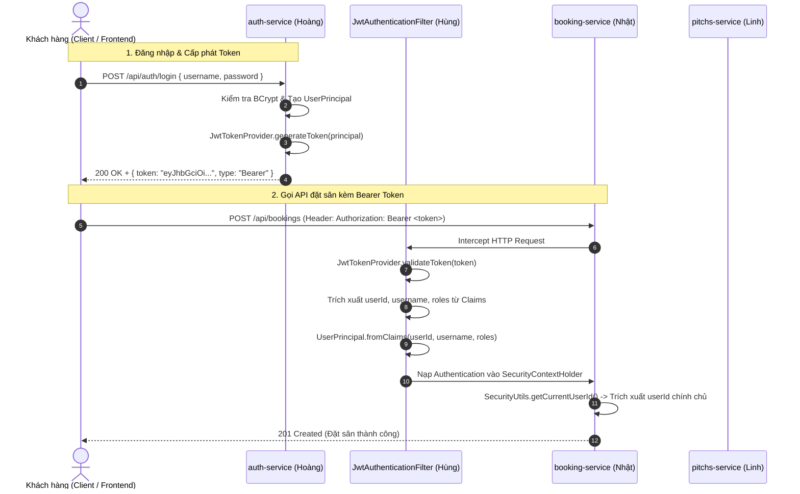

# BÁO CÁO THỰC HÀNH TUẦN 5 (TH5)
## CHUẨN COMMON-SECURITY DÙNG CHUNG; LƯU & KIỂM TRA USER

* **Học phần**: Phát triển phần mềm / Kiến trúc phần mềm chuyên sâu
* **Đề tài**: Hệ thống Quản lý và Đặt lịch Sân bóng đá (Football Pitch Booking System - Microservices)
* **Thành viên thực hiện**: **Vũ Đức Hùng (Hùng)**
* **Vai trò trong nhóm**: Database Administrator & Backend Data/Security Engineer
* **Nhánh Git (Branch)**: `feat/hung-data`
* **Ngày hoàn thành**: 15/11/2026

---

## 1. MỤC TIÊU & NHIỆM VỤ CỦA HÙNG TRONG TUẦN 5

Theo phân công công việc trong hệ thống (`BANG_PHAN_CONG_HANG_TUAN.xlsx`), nhiệm vụ cốt lõi của Hùng trong Tuần 5 là:
> **"Chuẩn common-security dùng chung; lưu & kiểm tra user."**

### Phân rã nhiệm vụ nhóm trong Tuần 5:
* **Hoàng (`auth-service`)**: Xây dựng API đăng ký/đăng nhập, băm mật khẩu BCrypt, cấp phát token JWT.
* **Linh (`pitchs-service`)**: Bảo vệ tài nguyên sân bóng bằng Security + RBAC (Chủ sân/Admin mới được thêm/sửa sân).
* **Nhật (`booking-service`)**: Tích hợp xác thực, trích xuất `userId` từ token JWT để tạo đơn đặt sân chính chủ, chống gian lận ID.
* **Hùng (`data-layer` / Common Layer)**:
  1. Đóng gói kiến trúc bảo mật thống nhất **Common Security** (`com.football.data.security`).
  2. Xây dựng bộ tiện ích **`JwtTokenProvider`** tương thích JJWT 0.12.x ký số HMAC-SHA256, phân giải và xác thực token.
  3. Xây dựng **`UserPrincipal`** (Spring Security `UserDetails`) hỗ trợ khôi phục đầy đủ ngữ cảnh (`id`, `username`, `roles`) trực tiếp từ JWT Claims **mà không cần truy vấn ngược CSDL `auth_db`**.
  4. Triển khai bộ lọc **`JwtAuthenticationFilter`** (`OncePerRequestFilter`) trích xuất Header `Bearer <token>` và nạp `Authentication` vào `SecurityContextHolder`.
  5. Thiết kế điểm chặn xử lý lỗi bảo mật tập trung **`JwtAuthenticationEntryPoint`** (401 Unauthorized) và **`CustomAccessDeniedHandler`** (403 Forbidden) trả về JSON chuẩn **RFC 7807 (`ErrorResponse`)**.
  6. Xây dựng lớp tiện ích tĩnh **`SecurityUtils`** giúp Controller và Service của bất kỳ microservice nào lấy `currentUserId`, `currentUsername` một cách an toàn luồng (Thread-safe).
  7. Cấu hình **`CommonSecurityConfig`** chuẩn hóa Stateless Session, tắt CSRF, cấu hình phân quyền RBAC và Method Security (`@PreAuthorize`).
  8. Xây dựng Controller kiểm chứng `SampleSecuredController` và bộ kiểm thử tự động toàn diện.

---

## 2. THIẾT KẾ KIẾN TRÚC BẢO MẬT PHÂN TÁN (STATELESS JWT)

### 2.1. Vấn đề kiến trúc trong mô hình Microservices
Trong kiến trúc phân tán Database-per-Service:
* Nếu mỗi khi nhận request, `booking-service` hay `pitchs-service` phải gọi REST qua `auth-service` hoặc kết nối vào `auth_db` để kiểm tra user:
  * Gây thắt cổ chai hiệu năng (Bottleneck) tại `auth-service`.
  * Vi phạm ranh giới cô lập dữ liệu (Database-per-Service Anti-pattern).
  * Làm tăng độ trễ (Latency) và tạo điểm lỗi đơn (Single Point of Failure - SPOF).
* **Giải pháp của Hùng**: Áp dụng mô hình **Cryptographically Signed Stateless JWT (Chữ ký số tự chứa ngữ cảnh)**.
  * Token JWT chứa sẵn `userId`, `username`, và danh sách `roles` trong payload (Claims).
  * Bất kỳ microservice nào nhận được token chỉ cần xác thực chữ ký số bằng Khóa bí mật chung (Shared HMAC Secret Key). Nếu chữ ký hợp lệ, service lập tức trích xuất được định danh người dùng mà không cần gọi mạng (Zero Network Overhead).



---

## 3. CHI TIẾT CÁC THÀNH PHẦN KỸ THUẬT ĐÃ THỰC HIỆN

### 3.1. Cấu hình tham số bảo mật (`JwtProperties.java`)
Đóng gói các cấu hình bảo mật với tiền tố `application.security.jwt`, hỗ trợ ghi đè linh hoạt qua `application.yml` hoặc biến môi trường container:
* Khóa bí mật ký số chuẩn HMAC-SHA256: Độ dài 256 bits (32 bytes).
* Thời hạn sống của Access Token: 24 giờ (`86400000 ms`).
* Thời hạn sống của Refresh Token: 7 ngày (`604800000 ms`).
* Header: `Authorization`, Tiền tố: `Bearer `.
* Đường dẫn: [JwtProperties.java](file:///c:/Users/viduc/Downloads/TH-PTPM/TH-PTPM/data-layer/src/main/java/com/football/data/security/JwtProperties.java)

### 3.2. Đối tượng định danh người dùng (`UserPrincipal.java`)
Cài đặt `UserDetails` của Spring Security:
* Lưu trữ `id` (`Long`), `username`, `fullName`, `phone`, `authorities`.
* Cung cấp 2 Factory Methods chiến lược:
  * `fromUser(User user)`: Dùng tại `auth-service` sau khi đối soát dữ liệu từ bảng `users`.
  * `fromClaims(Long id, String username, List<String> roles)`: Dùng tại các microservice vệ tinh (`pitchs`, `booking`, `payment`), phục hồi ngay `UserPrincipal` từ JWT Claims mà không cần kết nối CSDL.
* Đường dẫn: [UserPrincipal.java](file:///c:/Users/viduc/Downloads/TH-PTPM/TH-PTPM/data-layer/src/main/java/com/football/data/security/UserPrincipal.java)

### 3.3. Tiện ích xử lý & Xác thực Token (`JwtTokenProvider.java`)
Sử dụng thư viện hiện đại **JJWT 0.12.6**:
* `generateToken(...)`: Ký số với thuật toán HMAC-SHA256 (`Keys.hmacShaKeyFor`), nhúng các claims quan trọng: `userId`, `username`, `roles`, `iss`, `iat`, `exp`.
* `validateToken(token)`: Kiểm tra tính toàn vẹn chữ ký số và thời hạn hiệu lực. Bắt các ngoại lệ: `SecurityException`, `MalformedJwtException`, `ExpiredJwtException`, `UnsupportedJwtException`.
* `extractUserId(token)`: Xử lý an toàn tránh lỗi cast kiểu (`ClassCastException` giữa `Integer` và `Long` từ JSON payload).
* Đường dẫn: [JwtTokenProvider.java](file:///c:/Users/viduc/Downloads/TH-PTPM/TH-PTPM/data-layer/src/main/java/com/football/data/security/JwtTokenProvider.java)

### 3.4. Bộ lọc xác thực JWT (`JwtAuthenticationFilter.java`)
* Kế thừa `OncePerRequestFilter`, đảm bảo thực thi đúng một lần cho mỗi request.
* Trích xuất token từ header `Authorization: Bearer <token>`.
* Kiểm tra chữ ký số bằng `JwtTokenProvider.validateToken()`.
* Tái tạo `UserPrincipal` và tạo `UsernamePasswordAuthenticationToken`.
* Nạp vào `SecurityContextHolder.getContext().setAuthentication(authentication)` để toàn bộ hệ thống phía sau sử dụng.
* Đường dẫn: [JwtAuthenticationFilter.java](file:///c:/Users/viduc/Downloads/TH-PTPM/TH-PTPM/data-layer/src/main/java/com/football/data/security/JwtAuthenticationFilter.java)

### 3.5. Xử lý lỗi bảo mật chuẩn RFC 7807 (`JwtAuthenticationEntryPoint` & `CustomAccessDeniedHandler`)
Thay vì để Spring Security trả về trang HTML 401/403 mặc định, Hùng đã xây dựng 2 bộ xử lý chuyên biệt chuyển đổi lỗi sang định dạng JSON thống nhất của hệ thống:
1. **`JwtAuthenticationEntryPoint` (401 Unauthorized)**:
   * Kích hoạt khi client gọi API bảo mật nhưng không gửi token hoặc token sai/hết hạn.
   * Định dạng trả về:
     ```json
     {
       "timestamp": "2026-11-15T18:18:31",
       "status": 401,
       "error": "Unauthorized",
       "message": "Yêu cầu xác thực không hợp lệ hoặc thiếu token Bearer hợp lệ",
       "path": "/api/secured/customer/profile",
       "errorCode": "ERR_UNAUTHORIZED"
     }
     ```
   * Đường dẫn: [JwtAuthenticationEntryPoint.java](file:///c:/Users/viduc/Downloads/TH-PTPM/TH-PTPM/data-layer/src/main/java/com/football/data/security/JwtAuthenticationEntryPoint.java)
2. **`CustomAccessDeniedHandler` (403 Forbidden)**:
   * Kích hoạt khi người dùng đã xác thực nhưng không đủ quyền hạn (ví dụ `ROLE_CUSTOMER` cố tình truy cập tài nguyên quản trị `/api/secured/admin/**`).
   * Định dạng trả về:
     ```json
     {
       "timestamp": "2026-11-15T18:18:31",
       "status": 403,
       "error": "Forbidden",
       "message": "Bạn không có quyền hạn thực hiện hành động này (Quyền truy cập bị từ chối)",
       "path": "/api/secured/admin/users",
       "errorCode": "ERR_FORBIDDEN"
     }
     ```
   * Đường dẫn: [CustomAccessDeniedHandler.java](file:///c:/Users/viduc/Downloads/TH-PTPM/TH-PTPM/data-layer/src/main/java/com/football/data/security/CustomAccessDeniedHandler.java)

### 3.6. Tiện ích truy xuất thông tin người dùng (`SecurityUtils.java`)
Cung cấp các hàm tĩnh tiện lợi, kiểm tra null an toàn (Null-Safe) cho các lập trình viên khác:
* `SecurityUtils.getCurrentUserId()`: Lấy `Optional<Long>` ID người dùng hiện tại.
* `SecurityUtils.getCurrentUsername()`: Lấy `Optional<String>` tên đăng nhập.
* `SecurityUtils.getCurrentUserPrincipal()`: Lấy toàn bộ thông tin `UserPrincipal`.
* `SecurityUtils.hasRole("ADMIN")` / `SecurityUtils.hasAnyRole(...)`: Kiểm tra vai trò linh hoạt (tự động xử lý tiền tố `ROLE_`).
* Đường dẫn: [SecurityUtils.java](file:///c:/Users/viduc/Downloads/TH-PTPM/TH-PTPM/data-layer/src/main/java/com/football/data/security/SecurityUtils.java)

### 3.7. Cấu hình bảo mật hệ thống (`CommonSecurityConfig.java`)
* Kích hoạt `@EnableWebSecurity` và `@EnableMethodSecurity(prePostEnabled = true)`.
* Tắt CSRF (`csrf.disable()`) do kiến trúc REST API sử dụng token Bearer không phụ thuộc cookie/session.
* Cấu hình Session Creation Policy là `SessionCreationPolicy.STATELESS`.
* Phân quyền đường dẫn URL và tích hợp `JwtAuthenticationFilter` vào chuỗi lọc trước `UsernamePasswordAuthenticationFilter`.
* Cung cấp Bean `PasswordEncoder` (`BCryptPasswordEncoder`).
* Đường dẫn: [CommonSecurityConfig.java](file:///c:/Users/viduc/Downloads/TH-PTPM/TH-PTPM/data-layer/src/main/java/com/football/data/security/CommonSecurityConfig.java)

---

## 4. HƯỚNG DẪN TÍCH HỢP CHO CÁC THÀNH VIÊN TRONG ĐỘI NGŨ

### 4.1. Dành cho HOÀNG (`auth-service`)
1. **Băm mật khẩu khi người dùng đăng ký**:
   ```java
   @Autowired
   private PasswordEncoder passwordEncoder;

   // Khi đăng ký người dùng:
   String rawPassword = registerDTO.getPassword();
   String encodedPassword = passwordEncoder.encode(rawPassword);
   user.setPasswordHash(encodedPassword);
   userRepository.save(user);
   ```
2. **Cấp phát JWT Token khi đăng nhập thành công**:
   ```java
   @Autowired
   private JwtTokenProvider jwtTokenProvider;

   // Sau khi xác thực BCrypt thành công:
   UserPrincipal principal = UserPrincipal.fromUser(user);
   String token = jwtTokenProvider.generateToken(principal);

   return ResponseEntity.ok(ApiResponse.ok("Đăng nhập thành công", 
       new LoginResponseDTO(token, "Bearer", principal.getId(), principal.getUsername())));
   ```

### 4.2. Dành cho LINH (`pitchs-service`)
1. **Bảo vệ API quản lý sân bóng đá bằng `@PreAuthorize`**:
   ```java
   @RestController
   @RequestMapping("/api/pitches")
   public class PitchController {

       // Khách hàng bất kỳ đều có thể xem danh sách sân
       @GetMapping
       public ResponseEntity<?> getAllPitches() { ... }

       // Chỉ Chủ sân hoặc Admin mới được tạo sân mới
       @PostMapping
       @PreAuthorize("hasAnyRole('FIELD_OWNER', 'ADMIN')")
       public ResponseEntity<?> createPitch(@RequestBody PitchRequestDTO request) {
           Long ownerId = SecurityUtils.getCurrentUserId()
               .orElseThrow(() -> new UnauthorizedException("Yêu cầu xác thực tài khoản"));
           // Gán ownerId vào pitch...
       }
   }
   ```

### 4.3. Dành cho NHẬT (`booking-service`)
1. **Lấy `userId` chính chủ từ JWT Token (Chống gian lận đặt sân)**:
   ```java
   @RestController
   @RequestMapping("/api/bookings")
   public class BookingController {

       @PostMapping
       @PreAuthorize("hasRole('CUSTOMER')")
       public ResponseEntity<?> createBooking(@Valid @RequestBody BookingRequestDTO request) {
           // TRÍCH XUẤT TRỰC TIẾP TỪ JWT TOKEN - KHÔNG TIN TƯỞNG userId DO CLIENT GỬI LÊN
           Long currentUserId = SecurityUtils.getCurrentUserId()
               .orElseThrow(() -> new UnauthorizedException("Bạn phải đăng nhập để đặt sân"));

           // Gán ID chính chủ vào đơn đặt sân
           request.setUserId(currentUserId);
           
           return ResponseEntity.ok(bookingService.createBooking(request));
       }
   }
   ```

---

## 5. KẾT QUẢ KIỂM THỬ TỰ ĐỘNG (TEST SUITE VERIFICATION)

Bộ kiểm thử được thực thi tự động qua Maven Surefire. Tổng cộng **56 ca kiểm thử** đều vượt qua thành công (**100% Passed**, 0 Failures, 0 Errors).

### 5.1. Bảng phân phối kiểm thử Tuần 5:
| STT | Lớp Kiểm Thử (Test Class) | Số test | Kết quả | Ý nghĩa kiểm thử |
|:---:|:---|:---:|:---:|:---|
| 1 | `JwtTokenProviderTest` | 5 | **PASSED** | Sinh token, giải mã claims, phát hiện token hết hạn, token bị sửa đổi chữ ký, token rỗng/vô lệ |
| 2 | `SecurityUtilsTest` | 2 | **PASSED** | Kiểm tra trích xuất an toàn khi chưa xác thực và khi đã xác thực (User ID, Username, Role) |
| 3 | `CommonSecurityIntegrationTest` | 8 | **PASSED** | Kiểm thử chuỗi Filter thực tế với MockMvc: 401 khi thiếu token, 401 khi token hết hạn, 200 cho Customer hợp lệ, 403 khi Customer vào tài nguyên Admin, 200 cho Admin, 200 cho Field Owner, 403 với Method Security `@PreAuthorize`, trích xuất `/me` |
| 4 | Toàn bộ Unit & Integration Test cũ (TH1, TH2, TH3, TH4) | 41 | **PASSED** | Không phá vỡ (Zero-Regression) bất kỳ logic cũ nào của Repository, Transaction, Mapper, DTO |
| **Tổng** | **Toàn bộ Test Suite Dự án** | **56** | **PASSED (100%)** | **BUILD SUCCESS** |

---

## 6. DANH MỤC TỆP NGUỒN ĐÃ THỰC HIỆN TRONG TH5

1. [pom.xml](file:///c:/Users/viduc/Downloads/TH-PTPM/TH-PTPM/data-layer/pom.xml): Cập nhật `spring-boot-starter-security`, `jjwt-api`, `jjwt-impl`, `jjwt-jackson`, `spring-security-test`.
2. [JwtProperties.java](file:///c:/Users/viduc/Downloads/TH-PTPM/TH-PTPM/data-layer/src/main/java/com/football/data/security/JwtProperties.java): Cấu hình Secret Key 256-bit, thời hạn sống, Issuer.
3. [UserPrincipal.java](file:///c:/Users/viduc/Downloads/TH-PTPM/TH-PTPM/data-layer/src/main/java/com/football/data/security/UserPrincipal.java): Triển khai `UserDetails`, Factory method `fromUser` và `fromClaims`.
4. [JwtTokenProvider.java](file:///c:/Users/viduc/Downloads/TH-PTPM/TH-PTPM/data-layer/src/main/java/com/football/data/security/JwtTokenProvider.java): Ký số HMAC-SHA256, giải mã claims, kiểm tra hạn dùng và tính toàn vẹn chữ ký.
5. [JwtAuthenticationEntryPoint.java](file:///c:/Users/viduc/Downloads/TH-PTPM/TH-PTPM/data-layer/src/main/java/com/football/data/security/JwtAuthenticationEntryPoint.java): Xử lý lỗi 401 Unauthorized chuẩn RFC 7807.
6. [CustomAccessDeniedHandler.java](file:///c:/Users/viduc/Downloads/TH-PTPM/TH-PTPM/data-layer/src/main/java/com/football/data/security/CustomAccessDeniedHandler.java): Xử lý lỗi 403 Forbidden chuẩn RFC 7807.
7. [JwtAuthenticationFilter.java](file:///c:/Users/viduc/Downloads/TH-PTPM/TH-PTPM/data-layer/src/main/java/com/football/data/security/JwtAuthenticationFilter.java): Bộ lọc OncePerRequest trích xuất Bearer token và nạp `SecurityContextHolder`.
8. [SecurityUtils.java](file:///c:/Users/viduc/Downloads/TH-PTPM/TH-PTPM/data-layer/src/main/java/com/football/data/security/SecurityUtils.java): Tiện ích trích xuất `currentUserId`, `currentUsername`, kiểm tra Role an toàn luồng.
9. [CommonSecurityConfig.java](file:///c:/Users/viduc/Downloads/TH-PTPM/TH-PTPM/data-layer/src/main/java/com/football/data/security/CommonSecurityConfig.java): Cấu hình Stateless SecurityFilterChain, CORS, PasswordEncoder, URL RBAC.
10. [SampleSecuredController.java](file:///c:/Users/viduc/Downloads/TH-PTPM/TH-PTPM/data-layer/src/main/java/com/football/data/controller/SampleSecuredController.java): Controller minh họa các cấp phân quyền.
11. [JwtTokenProviderTest.java](file:///c:/Users/viduc/Downloads/TH-PTPM/TH-PTPM/data-layer/src/test/java/com/football/data/security/JwtTokenProviderTest.java): Kiểm thử ký và xác thực token JWT.
12. [SecurityUtilsTest.java](file:///c:/Users/viduc/Downloads/TH-PTPM/TH-PTPM/data-layer/src/test/java/com/football/data/security/SecurityUtilsTest.java): Kiểm thử tiện ích trích xuất người dùng.
13. [CommonSecurityIntegrationTest.java](file:///c:/Users/viduc/Downloads/TH-PTPM/TH-PTPM/data-layer/src/test/java/com/football/data/security/CommonSecurityIntegrationTest.java): Kiểm thử tích hợp toàn diện chuỗi lọc bảo mật.

