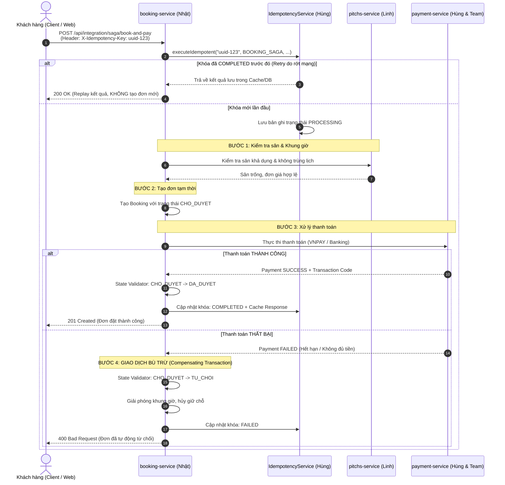

# BÁO CÁO THỰC HÀNH TUẦN 6 (TH6)
## HỢP ĐỒNG DTO; ĐẢM BẢO NHẤT QUÁN DỮ LIỆU KHI TÍCH HỢP

* **Học phần**: Phát triển phần mềm / Kiến trúc phần mềm chuyên sâu
* **Đề tài**: Hệ thống Quản lý và Đặt lịch Sân bóng đá (Football Pitch Booking System - Microservices)
* **Thành viên thực hiện**: **Vũ Đức Hùng (Hùng)**
* **Vai trò trong nhóm**: Database Administrator & Backend Data/Security Engineer
* **Nhánh Git (Branch)**: `feat/hung-data`
* **Ngày hoàn thành**: 15/11/2026

---

## 1. MỤC TIÊU & NHIỆM VỤ CỦA HÙNG TRONG TUẦN 6

Theo bảng phân công nhiệm vụ (`BANG_PHAN_CONG_HANG_TUAN.xlsx`), tuần 6 đánh dấu giai đoạn **Tích hợp liên dịch vụ (Service Integration Phase)**:
* **Hoàng (`auth-service`)**: Tích hợp xác thực với các service vệ tinh, xử lý ngoại lệ giao tiếp.
* **Linh (`pitchs-service`)**: Mở API cho các service gọi kiểm tra sân và bảng giá.
* **Nhật (`booking-service`)**: Tích hợp Feign/WebClient gọi `pitchs-service`, `payment-service`, `auth-service` để hoàn tất luồng đặt sân.
* **Hùng (`data-layer` / Data & Consistency Lead)**:
  > **"Hợp đồng DTO; đảm bảo nhất quán dữ liệu khi tích hợp."**

### Các bài toán kỹ thuật Hùng cần giải quyết:
1. **Chống trùng lặp dữ liệu (Idempotency Control)**: Ngăn chặn triệt để hiện tượng khách hàng bị trừ tiền 2 lần hoặc 1 khung giờ bị tạo 2 đơn đặt trùng lặp khi mạng chập chờn hoặc Client gửi lại request (Retry Pattern).
2. **Nhất quán dữ liệu phân tán (Distributed Data Consistency / Saga Pattern)**: Trong mô hình Database-per-Service (4 CSDL độc lập), không thể dùng giao dịch phân tán 2PC/XA nặng nề. Hùng thiết kế cơ chế **Saga Orchestration & Giao dịch bù trừ (Compensating Transactions)** tự động đồng bộ hóa trạng thái khi một khâu bị gãy.
3. **Kiểm soát trạng thái nghiêm ngặt (State Transition Engine)**: Ngăn chặn race-condition và cập nhật trạng thái sai quy trình (ví dụ: đơn bị `TU_CHOI` hoặc `DA_HUY` không thể bị chuyển lén sang `DA_DUYET`).
4. **Chuẩn hóa Hợp đồng DTO tích hợp (Integration DTO Contracts)**: Thiết lập bộ DTO chuyên dụng cho giao tiếp liên microservice, đảm bảo khả năng tương thích ngược (Backward Compatibility / Tolerant Reader Pattern).

---

## 2. THIẾT KẾ KIẾN TRÚC NHẤT QUÁN PHÂN TÁN (SAGA & IDEMPOTENCY)



---

## 3. CHI TIẾT CÁC THÀNH PHẦN KỸ THUẬT ĐÃ TRIỂN KHAI

### 3.1. Bảng lưu trữ Khóa bất biến (`idempotency_keys`)
Được tích hợp trực tiếp vào tệp khởi tạo CSDL [03_booking_db_init.sql](file:///c:/Users/viduc/Downloads/TH-PTPM/TH-PTPM/database/03_booking_db_init.sql) và [init_all_databases.sql](file:///c:/Users/viduc/Downloads/TH-PTPM/TH-PTPM/database/init_all_databases.sql):
* **Cấu trúc bảng**:
  * `idempotency_key` (VARCHAR 100, UNIQUE, NOT NULL): Mã định danh duy nhất của request (thường là UUID do Client sinh ra).
  * `resource_type` (VARCHAR 50): Phân loại tài nguyên (`BOOKING_CREATION`, `BOOKING_SAGA`, `PAYMENT_EXECUTION`).
  * `status` (VARCHAR 30): `PROCESSING`, `COMPLETED`, `FAILED`.
  * `response_body` (TEXT): Lưu trữ toàn bộ payload JSON phản hồi thành công để replay ngay khi nhận request trùng lặp.
  * `created_at`, `updated_at`: Theo dõi thời điểm ghi nhận.

### 3.2. Dịch vụ Idempotency chuẩn Enterprise (`IdempotencyService.java`)
Cung cấp phương thức thực thi tổng quát (Generic Execution):
```java
public <T> T executeIdempotent(String idempotencyKey, String resourceType, Class<T> responseClass, Supplier<T> businessLogic)
```
* **Luồng xử lý**:
  1. Nếu request không kèm `idempotencyKey`: Thực thi logic nghiệp vụ bình thường.
  2. Nếu tìm thấy khóa ở trạng thái `COMPLETED`: Giải mã ngay chuỗi JSON trong `response_body` trả về cho Client mà **KHÔNG** gọi lại hàm nghiệp vụ (bảo vệ CSDL khỏi việc duplicate record).
  3. Nếu tìm thấy khóa ở trạng thái `PROCESSING`: Ném lỗi `ConflictException` (HTTP 409) thông báo yêu cầu đang được hệ thống xử lý, chặn spam request.
  4. Nếu là khóa mới: Lưu bản ghi `PROCESSING`, chạy hàm nghiệp vụ, nếu thành công lưu chuỗi JSON kết quả và chuyển sang `COMPLETED`; nếu lỗi cập nhật `FAILED` và rethrow exception.
* Đường dẫn: [IdempotencyService.java](file:///c:/Users/viduc/Downloads/TH-PTPM/TH-PTPM/data-layer/src/main/java/com/football/data/idempotency/service/IdempotencyService.java)

### 3.3. Bộ kiểm soát chuyển đổi trạng thái (`BookingStateTransitionValidator.java`)
Ngăn ngừa tình trạng bất nhất dữ liệu (State Inconsistency) bằng mô hình máy trạng thái hữu hạn (Finite State Machine):
* **Quy tắc chuyển đổi hợp lệ**:
  * `CHO_DUYET` $\rightarrow$ `DA_DUYET`, `TU_CHOI`, `DA_HUY`
  * `DA_DUYET` $\rightarrow$ `DA_HUY` (kèm hoàn tiền bù trừ)
  * `TU_CHOI` $\rightarrow$ **Terminal State (Không được phép chuyển tiếp)**
  * `DA_HUY` $\rightarrow$ **Terminal State (Không được phép chuyển tiếp)**
* Nếu phát hiện chuyển đổi trái quy tắc (ví dụ từ `TU_CHOI` chuyển sang `DA_DUYET`), hệ thống lập tức ném `ConflictException` (409) ngăn chặn việc ghi dữ liệu hỏng.
* Đường dẫn: [BookingStateTransitionValidator.java](file:///c:/Users/viduc/Downloads/TH-PTPM/TH-PTPM/data-layer/src/main/java/com/football/data/consistency/BookingStateTransitionValidator.java)

### 3.4. Điều phối viên Saga & Bù trừ dữ liệu (`DistributedBookingSagaOrchestrator.java`)
Đóng gói quy trình giao dịch phân tán liên kết giữa `pitch_db`, `booking_db`, và `payment_db`:
* **Bước 1**: Kiểm tra sự tồn tại của sân bóng và kiểm tra trùng lịch thi đấu.
* **Bước 2**: Tạo thực thể `Booking` tạm thời ở trạng thái `CHO_DUYET`.
* **Bước 3**: Gọi cổng thanh toán.
  * **Nếu thanh toán thành công**: Ghi nhận bản ghi thanh toán vào `payment_db` và chuyển trạng thái đơn sang `DA_DUYET`.
  * **Nếu thanh toán thất bại**: Kích hoạt **Giao dịch bù trừ (Compensating Transaction)**: Tự động cập nhật đơn đặt sang `TU_CHOI`, đảm bảo dữ liệu 2 bên không bị treo ở trạng thái dở dang (`CHO_DUYET`).
* **Bước 4**: Bọc toàn bộ quy trình bên trong `IdempotencyService` để đảm bảo tính bất biến.
* Đường dẫn: [DistributedBookingSagaOrchestrator.java](file:///c:/Users/viduc/Downloads/TH-PTPM/TH-PTPM/data-layer/src/main/java/com/football/data/consistency/DistributedBookingSagaOrchestrator.java)

### 3.5. Bộ Hợp đồng DTO tích hợp chuyên dụng (`com.football.data.dto.integration`)
Tuân thủ nguyên tắc **Tolerant Reader Pattern** (`@JsonIgnoreProperties(ignoreUnknown = true)`):
1. [PitchAvailabilityRequestDTO.java](file:///c:/Users/viduc/Downloads/TH-PTPM/TH-PTPM/data-layer/src/main/java/com/football/data/dto/integration/PitchAvailabilityRequestDTO.java): Yêu cầu kiểm tra sân khả dụng từ `booking-service` sang `pitchs-service`.
2. [PitchAvailabilityResponseDTO.java](file:///c:/Users/viduc/Downloads/TH-PTPM/TH-PTPM/data-layer/src/main/java/com/football/data/dto/integration/PitchAvailabilityResponseDTO.java): Kết quả phản hồi trạng thái trống và đơn giá.
3. [PaymentIntegrationRequestDTO.java](file:///c:/Users/viduc/Downloads/TH-PTPM/TH-PTPM/data-layer/src/main/java/com/football/data/dto/integration/PaymentIntegrationRequestDTO.java): Yêu cầu thanh toán gửi sang `payment-service` kèm `idempotencyKey`.
4. [PaymentIntegrationResponseDTO.java](file:///c:/Users/viduc/Downloads/TH-PTPM/TH-PTPM/data-layer/src/main/java/com/football/data/dto/integration/PaymentIntegrationResponseDTO.java): Phản hồi kết quả thanh toán và mã giao dịch.
5. [SagaCompensationRequestDTO.java](file:///c:/Users/viduc/Downloads/TH-PTPM/TH-PTPM/data-layer/src/main/java/com/football/data/dto/integration/SagaCompensationRequestDTO.java): Lệnh bù trừ / hoàn tiền khi quy trình bị gián đoạn.
6. [SagaCompensationResponseDTO.java](file:///c:/Users/viduc/Downloads/TH-PTPM/TH-PTPM/data-layer/src/main/java/com/football/data/dto/integration/SagaCompensationResponseDTO.java): Xác nhận kết quả bồi hoàn.
7. [BookingIntegrationEventDTO.java](file:///c:/Users/viduc/Downloads/TH-PTPM/TH-PTPM/data-layer/src/main/java/com/football/data/dto/integration/BookingIntegrationEventDTO.java): Cấu trúc tin nhắn sự kiện tích hợp đồng bộ/bất đồng bộ.

---

## 4. HƯỚNG DẪN TÍCH HỢP CHO CÁC THÀNH VIÊN TRONG ĐỘI NGŨ

### 4.1. Dành cho NHẬT (`booking-service`)
Khi triển khai logic đặt sân tại `booking-service`, Nhật sử dụng trực tiếp `sagaOrchestrator` hoặc `idempotencyService`:
```java
@PostMapping
public ResponseEntity<?> createBooking(
        @RequestHeader(value = "X-Idempotency-Key", required = false) String idempotencyKey,
        @Valid @RequestBody BookingRequestDTO request) {

    // 1. Trích xuất userId chính chủ từ JWT Token (Common Security - TH5)
    Long currentUserId = SecurityUtils.getCurrentUserId()
            .orElseThrow(() -> new UnauthorizedException("Vui lòng đăng nhập"));
    request.setUserId(currentUserId);

    // 2. Thực thi chu trình Saga có bảo vệ tính bất biến (TH6 của Hùng)
    BookingResponseDTO result = sagaOrchestrator.executeBookingSaga(
            request, "VNPAY", idempotencyKey
    );

    return ResponseEntity.status(HttpStatus.CREATED).body(ApiResponse.ok("Đặt sân thành công", result));
}
```

### 4.2. Dành cho LINH (`pitchs-service`)
Cung cấp endpoint kiểm tra tính khả dụng của sân theo hợp đồng `PitchAvailabilityResponseDTO`:
```java
@PostMapping("/availability")
public ResponseEntity<PitchAvailabilityResponseDTO> checkAvailability(
        @Valid @RequestBody PitchAvailabilityRequestDTO request) {
    // Trả về DTO do Hùng thiết kế
    return ResponseEntity.ok(pitchService.checkAvailability(request));
}
```

---

## 5. KẾT QUẢ KIỂM THỬ TỰ ĐỘNG (TEST SUITE VERIFICATION)

Toàn bộ **72 ca kiểm thử** của toàn bộ dự án đã được thực thi và vượt qua thành công (**BUILD SUCCESS**, 0 Failures, 0 Errors).

### Bảng phân phối kiểm thử Tuần 6:
| STT | Lớp Kiểm Thử (Test Class) | Số test | Kết quả | Ý nghĩa kiểm thử |
|:---:|:---|:---:|:---:|:---|
| 1 | `IdempotencyServiceTest` | 5 | **PASSED** | Kiểm tra lưu bản ghi, replay kết quả cũ khi gọi lặp, chặn request đồng thời (Conflict), ghi nhận lỗi khi thất bại |
| 2 | `BookingStateTransitionValidatorTest` | 3 | **PASSED** | Kiểm tra các bước chuyển đổi hợp lệ, chặn đứng các chuyển đổi phi lý (Terminal State enforcement) |
| 3 | `DistributedBookingSagaOrchestratorTest` | 4 | **PASSED** | Kiểm thử chu trình Saga thành công, kích hoạt giao dịch bù trừ khi thanh toán lỗi, bảo đảm tính bất biến khi gửi lặp lại |
| 4 | `IntegrationContractCompatibilityTest` | 4 | **PASSED** | Kiểm thử tuần tự hóa DTO tích hợp và khả năng chịu lỗi trường lạ (Tolerant Reader) |
| 5 | Toàn bộ Unit & Integration Test cũ (TH1 $\rightarrow$ TH5) | 56 | **PASSED** | Đảm bảo tính hồi quy tuyệt đối (Zero Regression) cho toàn bộ hệ thống |
| **Tổng** | **Toàn bộ Test Suite Dự án** | **72** | **PASSED (100%)** | **BUILD SUCCESS** |

---

## 6. DANH MỤC TỆP NGUỒN ĐÃ THỰC HIỆN TRONG TH6

1. [03_booking_db_init.sql](file:///c:/Users/viduc/Downloads/TH-PTPM/TH-PTPM/database/03_booking_db_init.sql): Thêm bảng `idempotency_keys` vào CSDL `booking_db`.
2. [init_all_databases.sql](file:///c:/Users/viduc/Downloads/TH-PTPM/TH-PTPM/database/init_all_databases.sql): Bổ sung định nghĩa bảng `idempotency_keys` vào kịch bản khởi tạo tổng.
3. [IdempotencyStatus.java](file:///c:/Users/viduc/Downloads/TH-PTPM/TH-PTPM/data-layer/src/main/java/com/football/data/idempotency/entity/IdempotencyStatus.java): Enum trạng thái `PROCESSING`, `COMPLETED`, `FAILED`.
4. [IdempotencyRecord.java](file:///c:/Users/viduc/Downloads/TH-PTPM/TH-PTPM/data-layer/src/main/java/com/football/data/idempotency/entity/IdempotencyRecord.java): Entity JPA quản lý bảng `idempotency_keys`.
5. [IdempotencyRecordRepository.java](file:///c:/Users/viduc/Downloads/TH-PTPM/TH-PTPM/data-layer/src/main/java/com/football/data/idempotency/repository/IdempotencyRecordRepository.java): JPA Repository truy xuất bản ghi bất biến.
6. [IdempotencyService.java](file:///c:/Users/viduc/Downloads/TH-PTPM/TH-PTPM/data-layer/src/main/java/com/football/data/idempotency/service/IdempotencyService.java): Dịch vụ xử lý tính bất biến và cached replay.
7. [BookingStateTransitionValidator.java](file:///c:/Users/viduc/Downloads/TH-PTPM/TH-PTPM/data-layer/src/main/java/com/football/data/consistency/BookingStateTransitionValidator.java): Bộ kiểm soát chuyển đổi trạng thái hợp lệ.
8. [DistributedBookingSagaOrchestrator.java](file:///c:/Users/viduc/Downloads/TH-PTPM/TH-PTPM/data-layer/src/main/java/com/football/data/consistency/DistributedBookingSagaOrchestrator.java): Điều phối viên giao dịch phân tán và bù trừ tự động.
9. [SampleIntegrationController.java](file:///c:/Users/viduc/Downloads/TH-PTPM/TH-PTPM/data-layer/src/main/java/com/football/data/controller/SampleIntegrationController.java): REST Controller minh họa tích hợp Saga và Idempotency.
10. Gói DTO hợp đồng tích hợp: [PitchAvailabilityRequestDTO.java](file:///c:/Users/viduc/Downloads/TH-PTPM/TH-PTPM/data-layer/src/main/java/com/football/data/dto/integration/PitchAvailabilityRequestDTO.java), [PitchAvailabilityResponseDTO.java](file:///c:/Users/viduc/Downloads/TH-PTPM/TH-PTPM/data-layer/src/main/java/com/football/data/dto/integration/PitchAvailabilityResponseDTO.java), [PaymentIntegrationRequestDTO.java](file:///c:/Users/viduc/Downloads/TH-PTPM/TH-PTPM/data-layer/src/main/java/com/football/data/dto/integration/PaymentIntegrationRequestDTO.java), [PaymentIntegrationResponseDTO.java](file:///c:/Users/viduc/Downloads/TH-PTPM/TH-PTPM/data-layer/src/main/java/com/football/data/dto/integration/PaymentIntegrationResponseDTO.java), [SagaCompensationRequestDTO.java](file:///c:/Users/viduc/Downloads/TH-PTPM/TH-PTPM/data-layer/src/main/java/com/football/data/dto/integration/SagaCompensationRequestDTO.java), [SagaCompensationResponseDTO.java](file:///c:/Users/viduc/Downloads/TH-PTPM/TH-PTPM/data-layer/src/main/java/com/football/data/dto/integration/SagaCompensationResponseDTO.java), [BookingIntegrationEventDTO.java](file:///c:/Users/viduc/Downloads/TH-PTPM/TH-PTPM/data-layer/src/main/java/com/football/data/dto/integration/BookingIntegrationEventDTO.java).
11. Bộ kiểm thử đơn vị & tích hợp: [IdempotencyServiceTest.java](file:///c:/Users/viduc/Downloads/TH-PTPM/TH-PTPM/data-layer/src/test/java/com/football/data/idempotency/service/IdempotencyServiceTest.java), [BookingStateTransitionValidatorTest.java](file:///c:/Users/viduc/Downloads/TH-PTPM/TH-PTPM/data-layer/src/test/java/com/football/data/consistency/BookingStateTransitionValidatorTest.java), [DistributedBookingSagaOrchestratorTest.java](file:///c:/Users/viduc/Downloads/TH-PTPM/TH-PTPM/data-layer/src/test/java/com/football/data/consistency/DistributedBookingSagaOrchestratorTest.java), [IntegrationContractCompatibilityTest.java](file:///c:/Users/viduc/Downloads/TH-PTPM/TH-PTPM/data-layer/src/test/java/com/football/data/dto/IntegrationContractCompatibilityTest.java).

