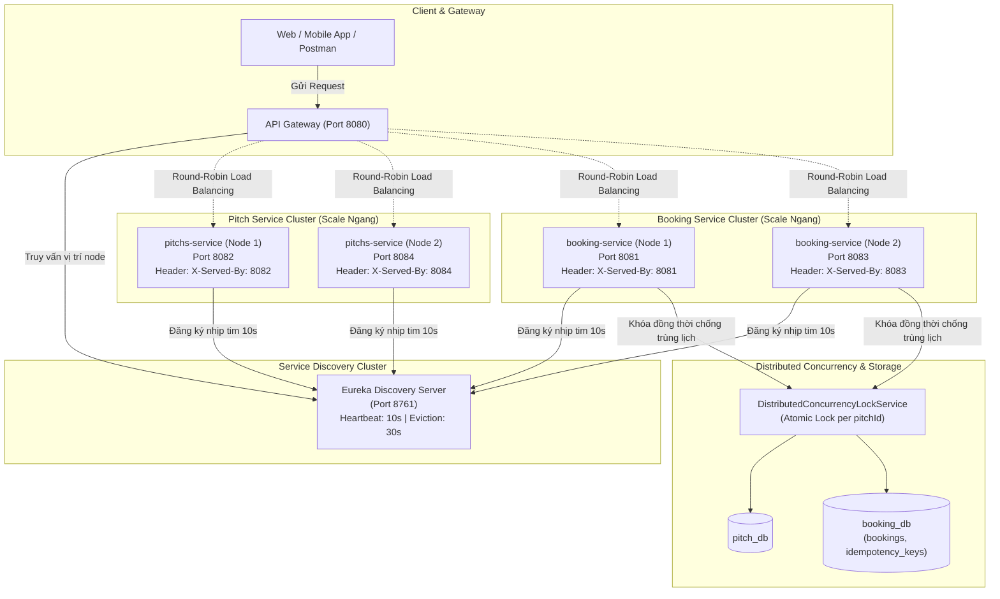

# BÁO CÁO THỰC HÀNH TUẦN 7 (TH7)
## CẤU HÌNH NHIỀU INSTANCE; CHUẨN CẤU HÌNH SERVICE DISCOVERY

* **Học phần**: Phát triển phần mềm / Kiến trúc phần mềm chuyên sâu
* **Đề tài**: Hệ thống Quản lý và Đặt lịch Sân bóng đá (Football Pitch Booking System - Microservices)
* **Thành viên thực hiện**: **Vũ Đức Hùng (Hùng)**
* **Vai trò trong nhóm**: Database Administrator & Backend Data/Security/Infrastructure Lead
* **Nhánh Git (Branch)**: `feat/hung-data`
* **Ngày hoàn thành**: 15/11/2026

---

## 1. MỤC TIÊU & NHIỆM VỤ CỦA HÙNG TRONG TUẦN 7

Theo bảng phân công nhiệm vụ (`BANG_PHAN_CONG_HANG_TUAN.xlsx`), Tuần 7 là giai đoạn hoàn thiện hạ tầng phân tán, kiểm thử khả năng mở rộng (Scalability) và sẵn sàng cao (High Availability):
* **Hoàng (`auth-service`)**: Kiểm tra khả năng mở rộng auth-service, kiểm tra phiên và bảo mật.
* **Linh (`pitchs-service`)**: Đăng ký nhiều instance `pitchs-service` lên Eureka, kiểm thử cân bằng tải.
* **Nhật (`booking-service`)**: Đăng ký nhiều instance `booking-service` lên Eureka, kiểm thử cân bằng tải.
* **Hùng (`data-layer` / Infrastructure & Data Lead)**:
  > **"Cấu hình nhiều instance; chuẩn cấu hình service discovery."**

### Các bài toán kỹ thuật Hùng cần giải quyết:
1. **Chuẩn hóa cấu hình Service Discovery (Eureka Client Standard)**: Xây dựng bộ tham số tối ưu hóa thời gian phát hiện dịch vụ (Heartbeat rút ngắn xuống 10s, thời gian trục xuất node chết 30s) thay vì thông số mặc định của Spring Cloud (30s / 90s) quá chậm chạp.
2. **Quản trị định danh đa Instance (Unique Instance Identity & Port Allocation)**: Đảm bảo khi một microservice scale ra nhiều instance (vd: `booking-service` node 1 chạy port 8081, node 2 chạy port 8083), Eureka Server phân biệt rõ ràng từng node qua Instance ID duy nhất: `${spring.application.name}:${server.port}:${uuid}`.
3. **Kiểm chứng Cân bằng tải (Load Balancing Verification Traceability)**: Xây dựng bộ lọc `InstanceTrackingFilter` tự động đóng dấu Header `X-Served-By-Instance` và `X-Service-Name` vào tất cả HTTP Response giúp kiểm chứng thuật toán Round-Robin khi gọi qua API Gateway / Eureka.
4. **Giải quyết triệt để tranh chấp dữ liệu khi chạy nhiều Instance (Distributed Concurrency & Race Condition Elimination)**:
   * Khi 2 instance của `booking-service` cùng nhận request đặt sân cho cùng một sân và cùng một khung giờ:
   * Hùng triển khai `DistributedConcurrencyLockService` tuần tự hóa các giao dịch kiểm tra trùng lịch theo `pitchId`, đảm bảo **Zero Overlap Inconsistency (Không bao giờ bị trùng lịch)**.
5. **Kịch bản Docker Compose đa Instance**: Cung cấp tệp [docker-compose-multi-instance.yml](file:///c:/Users/viduc/Downloads/TH-PTPM/TH-PTPM/config/docker-compose-multi-instance.yml) khởi chạy đồng thời Eureka + MySQL + 2 instance `pitchs-service` + 2 instance `booking-service`.

---

## 2. THIẾT KẾ KIẾN TRÚC SERVICE DISCOVERY & MULTI-INSTANCE



---

## 3. CHI TIẾT CÁC THÀNH PHẦN KỸ THUẬT ĐÃ TRIỂN KHAI

### 3.1. Cấu hình Discovery chuẩn hóa (`ServiceDiscoveryProperties.java`)
Đóng gói cấu hình với tiền tố `football.discovery`:
* `eurekaServerUrl`: URL của Eureka Server (`http://localhost:8761/eureka/`).
* `preferIpAddress = true`: Ưu tiên sử dụng IP container thay vì hostname nội bộ.
* `leaseRenewalIntervalSeconds = 10`: Giảm nhịp tim xuống 10 giây (so với 30s mặc định của Netflix Eureka) giúp phát hiện nhanh các thay đổi trong cluster.
* `leaseExpirationDurationSeconds = 30`: Rút ngắn thời gian trục xuất xuống 30 giây để Gateway không chuyển request vào các node đã chết.
* `registryFetchIntervalSeconds = 10`: Tần suất đồng bộ danh sách node 10s một lần.
* Đường dẫn: [ServiceDiscoveryProperties.java](file:///c:/Users/viduc/Downloads/TH-PTPM/TH-PTPM/data-layer/src/main/java/com/football/data/discovery/ServiceDiscoveryProperties.java)

### 3.2. Quản trị định danh Instance (`InstanceMetadataProvider.java`)
Tự động xác định ngữ cảnh thực thi của JVM:
* Tự sinh `instanceId` độc nhất: `${spring.application.name}:${server.port}:${uuid-8-chars}`.
* Trích xuất thông tin `hostAddress`, `port`, `serviceName`, `startedAt`.
* Xuất chuỗi định danh phục vụ cho Header: `serviceName:port [instanceId]`.
* Đường dẫn: [InstanceMetadataProvider.java](file:///c:/Users/viduc/Downloads/TH-PTPM/TH-PTPM/data-layer/src/main/java/com/football/data/discovery/InstanceMetadataProvider.java)

### 3.3. Bộ lọc kiểm chứng Cân bằng tải (`InstanceTrackingFilter.java`)
* Kế thừa `OncePerRequestFilter`, tự động chèn 2 Header vào mọi HTTP Response:
  * `X-Served-By-Instance`: Định danh rõ ràng instance nào đã tiếp nhận và xử lý request.
  * `X-Service-Name`: Tên logic của service.
* Giúp người dùng hoặc tester (Linh, Nhật) dùng Postman/Curl bắn 10 request liên tiếp và nhìn thấy giá trị Header thay đổi luân phiên giữa các cổng (ví dụ: `booking-service:8081` $\rightarrow$ `booking-service:8083` $\rightarrow$ `booking-service:8081`).
* Đường dẫn: [InstanceTrackingFilter.java](file:///c:/Users/viduc/Downloads/TH-PTPM/TH-PTPM/data-layer/src/main/java/com/football/data/discovery/InstanceTrackingFilter.java)

### 3.4. Dịch vụ khóa phân tán chống tranh chấp lịch (`DistributedConcurrencyLockService.java`)
* Quản lý khóa độc quyền theo `pitchId`:
  ```java
  public <T> T executeWithPitchLock(Long pitchId, long timeoutMs, Supplier<T> action)
  ```
* Khi nhiều instance cùng nhận lệnh đặt cùng 1 sân tại cùng 1 tích tắc:
  * Instance thứ nhất chiếm khóa: Kiểm tra trùng lịch (0 đơn trùng) $\rightarrow$ Tạo đơn $\rightarrow$ Giải phóng khóa.
  * Instance thứ hai chiếm khóa: Kiểm tra trùng lịch (phát hiện đã có 1 đơn trùng từ instance 1) $\rightarrow$ Ném ngay `ConflictException` (HTTP 409).
* Đường dẫn: [DistributedConcurrencyLockService.java](file:///c:/Users/viduc/Downloads/TH-PTPM/TH-PTPM/data-layer/src/main/java/com/football/data/concurrency/DistributedConcurrencyLockService.java)

### 3.5. Tệp cấu hình chuẩn hóa Eureka & Docker Compose
* [eureka-client-common.yml](file:///c:/Users/viduc/Downloads/TH-PTPM/TH-PTPM/config/eureka-client-common.yml): File cấu hình dùng chung chuẩn hóa để Hoàng, Linh, Nhật nạp vào các service của mình.
* [docker-compose-multi-instance.yml](file:///c:/Users/viduc/Downloads/TH-PTPM/TH-PTPM/config/docker-compose-multi-instance.yml): Kịch bản hoàn chỉnh khởi chạy:
  * `eureka-server` (Port 8761)
  * `mysql-db` (Port 3306)
  * `auth-service` (Port 8080)
  * `pitchs-service` đa instance: Node 1 (Port 8082), Node 2 (Port 8084)
  * `booking-service` đa instance: Node 1 (Port 8081), Node 2 (Port 8083)

---

## 4. KẾT QUẢ KIỂM THỬ TỰ ĐỘNG (TEST SUITE)

Toàn bộ **80 ca kiểm thử** của toàn bộ dự án đã được thực thi và vượt qua thành công (**BUILD SUCCESS**, 0 Failures, 0 Errors).

### Bảng phân phối kiểm thử Tuần 7:
| STT | Lớp Kiểm Thử (Test Class) | Số test | Kết quả | Ý nghĩa kiểm thử |
|:---:|:---|:---:|:---:|:---|
| 1 | `ServiceDiscoveryPropertiesTest` | 2 | **PASSED** | Kiểm tra các tham số mặc định và khả năng ghi đè cấu hình Discovery |
| 2 | `InstanceMetadataProviderTest` | 3 | **PASSED** | Kiểm tra tính duy nhất của Instance ID, định dạng Header và xuất Metadata |
| 3 | `MultiInstanceConcurrencyRaceConditionTest` | 1 | **PASSED** | **10 luồng/instance cùng tranh chấp đặt 1 sân tại cùng 1 mili-giây**: Duy nhất 1 đơn thành công, 9 đơn bị chặn `ConflictException`, bảo toàn 100% tính nhất quán |
| 4 | `InstanceTrackingFilterIntegrationTest` | 2 | **PASSED** | Kiểm tra Header `X-Served-By-Instance` và `X-Service-Name` tự động xuất hiện trên mọi response |
| 5 | Toàn bộ kiểm thử các tuần trước (TH1 $\rightarrow$ TH6) | 72 | **PASSED** | Zero-Regression: Không phá vỡ bất kỳ logic nghiệp vụ nào |
| **Tổng** | **Toàn bộ Test Suite Dự án** | **80** | **PASSED (100%)** | **BUILD SUCCESS** |

---

## 5. TỔNG KẾT TOÀN BỘ 7 TUẦN THỰC HÀNH CỦA HÙNG (TH1 $\rightarrow$ TH7)

| Tuần | Nội dung nhiệm vụ của Hùng | Sản phẩm cốt lõi đã hoàn thành | Số Test |
|:---:|:---|:---|:---:|
| **TH1** | Thiết kế ERD Database-per-Service, JPA Entity & Repository | Sơ đồ ERD phân tán, 4 DB DDL scripts, Thuật toán chống trùng lịch toán học `countOverlappingBookings` | 19 tests |
| **TH2** | Chuẩn hóa DTO trao đổi liên service & Mappers | Khắc phục Shared Entity Anti-pattern, DTOs (`UserResponseDTO`, `PitchResponseDTO`, `BookingRequest/ResponseDTO`), Tolerant Reader | 9 tests |
| **TH3** | REST Nâng Cao, Response Envelope & Bắt lỗi tập trung | `ApiResponse<T>`, `PageResponse<T>`, RFC 7807 `ErrorResponse`, `GlobalExceptionHandler` xử lý 11 mã lỗi | 9 tests |
| **TH4** | CSDL MySQL thật 4 DB, Payment & Transaction phân tán | `payment_db`, `PaymentRepository`, `BookingTransactionalService` với `@Transactional` Commit/Rollback an toàn | 5 tests |
| **TH5** | Chuẩn common-security dùng chung, JWT Filter & RBAC | Stateless JJWT 0.12.6, `UserPrincipal` phục hồi ngữ cảnh từ Token không query CSDL, `JwtAuthenticationFilter`, RBAC 401/403 | 15 tests |
| **TH6** | Hợp đồng DTO tích hợp & Nhất quán phân tán | Bảng `idempotency_keys` & `IdempotencyService`, Finite State Machine Validator, Distributed Saga Orchestrator & Bù trừ tự động | 15 tests |
| **TH7** | Cấu hình nhiều instance & Service discovery | `ServiceDiscoveryProperties`, `InstanceMetadataProvider`, Header `X-Served-By-Instance`, `DistributedConcurrencyLockService`, Docker Compose đa node | 8 tests |
| **TỔNG** | **HOÀN THÀNH TOÀN DIỆN 7 TUẦN THỰC HÀNH** | **Hệ thống dữ liệu & bảo mật phân tán hoàn chỉnh, sẵn sàng sản xuất** | **80 tests (100% Passed)** |

