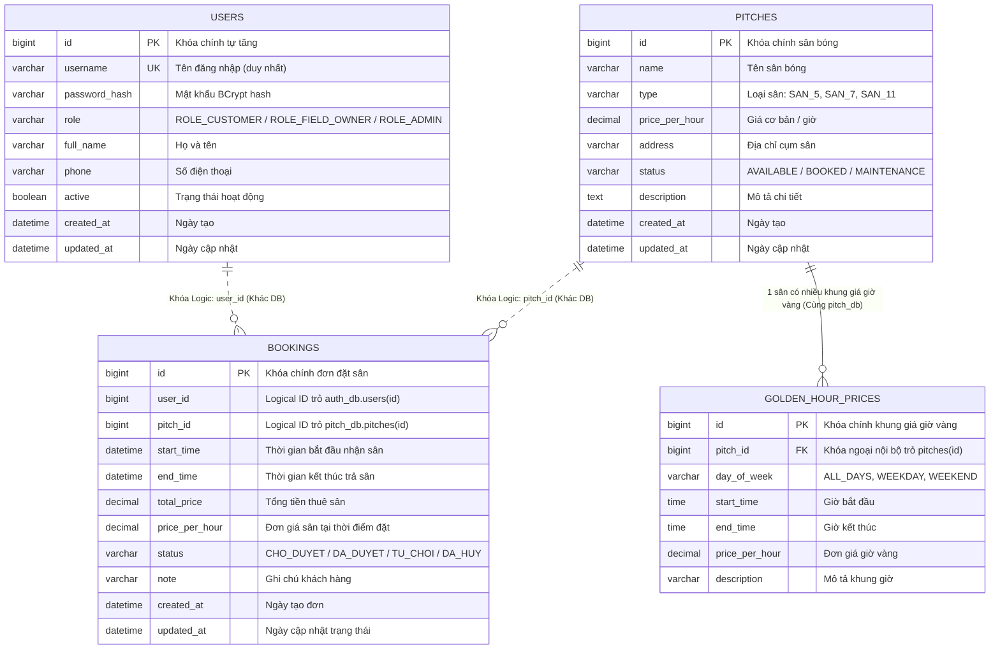

# TÀI LIỆU THIẾT KẾ SƠ ĐỒ THỰC THỂ QUAN HỆ (ERD) & KIẾN TRÚC DỮ LIỆU PHÂN TÁN

> **Dự án:** Hệ thống Quản lý Đặt lịch Sân bóng đá (Football Booking System)  
> **Học phần:** Phát triển phần mềm hướng dịch vụ (SOA) / Kiến trúc phần mềm  
> **Người thực hiện:** HÙNG (Data Administrator & Backend Data Engineer)  
> **Nhánh Git:** `feat/hung-data`  
> **Phần việc:** Tuần 1 (TH1) — Thiết kế @Entity + Repository cho User / Booking / Pitch; Dựng ERD

---

## 1. TỔNG QUAN KIẾN TRÚC DỮ LIỆU HỆ THỐNG

Trong các hệ thống nguyên khối (Monolith), toàn bộ các thực thể như Người dùng (`users`), Sân bóng (`pitches`), Đơn đặt sân (`bookings`) thường được đặt trong cùng một cơ sở dữ liệu quan hệ duy nhất và liên kết với nhau bằng các ràng buộc khóa ngoại vật lý (`FOREIGN KEY`). Mặc dù cách làm này đảm bảo tính toàn vẹn tham chiếu (Referential Integrity) ở mức CSDL một cách dễ dàng, nhưng nó vi phạm nghiêm trọng các nguyên tắc cốt lõi của **Microservices**:
* **Ghép nối lược đồ dữ liệu (Schema Coupling):** Mọi sự thay đổi về schema của một bảng có thể làm sụp đổ các dịch vụ khác.
* **Mất khả năng triển khai độc lập (Independent Deployment):** Không thể triển khai độc lập từng microservice khi chúng cùng ràng buộc khóa ngoại vật lý chéo database.
* **Nghẽn cổ chai và Deadlock chéo (Cross-database Contention):** Khóa dòng hoặc khóa bảng có thể lan truyền qua các transaction liên dịch vụ.

Để giải quyết bài toán trên, hệ thống áp dụng triệt để nguyên tắc **Database-per-Service**:
* Mỗi dịch vụ sở hữu độc quyền cơ sở dữ liệu của mình:
  1. `auth-service` $\rightarrow$ Quản trị CSDL `auth_db`
  2. `pitchs-service` $\rightarrow$ Quản trị CSDL `pitch_db`
  3. `booking-service` $\rightarrow$ Quản trị CSDL `booking_db`
* Dữ liệu giữa các dịch vụ được liên kết lỏng (Loosely Coupled) thông qua **Khóa Logic (Logical ID)** thay vì Khóa ngoại vật lý (Physical Foreign Key).

---

## 2. SƠ ĐỒ ERD TỔNG THỂ (MERMAID)



---

## 3. THIẾT KẾ CHI TIẾT TỪNG MIỀN DỮ LIỆU (BOUNDED CONTEXTS)

### 3.1. Miền Dữ liệu Xác thực & Phân quyền (`auth_db`)
* **Mục đích:** Quản lý danh tính, phân quyền vai trò (Role-Based Access Control - RBAC) và thông tin liên hệ của các tác nhân (Khách hàng, Chủ sân, Quản trị viên).
* **Bảng chính:** `users`
  * `id` (`BIGINT`, PK, Auto Increment): Định danh người dùng duy nhất toàn hệ thống.
  * `username` (`VARCHAR(50)`, Unique, Not Null): Tên đăng nhập.
  * `password_hash` (`VARCHAR(255)`, Not Null): Mật khẩu băm chuẩn an toàn BCrypt (độ dài 60 ký tự).
  * `role` (`VARCHAR(30)`, Not Null): Enum phân quyền gồm `ROLE_CUSTOMER`, `ROLE_FIELD_OWNER`, `ROLE_ADMIN`, `ROLE_INTERNAL_SERVICE`.
  * `full_name` (`VARCHAR(100)`, Not Null): Họ và tên hiển thị.
  * `phone` (`VARCHAR(15)`, Not Null): Số điện thoại liên hệ để xác minh lượt đặt sân.
  * `active` (`BOOLEAN`, Default TRUE): Cờ trạng thái tài khoản.
  * `created_at`, `updated_at`: Thời gian kiểm toán (Auditing timestamps).
* **Chỉ mục (Indexes):**
  * `uk_users_username` (Unique Index): Ngăn trùng lặp tên đăng nhập ở mức đĩa cứng.
  * `idx_users_phone`: Tăng tốc độ tra cứu người dùng qua số điện thoại.
  * `idx_users_role`: Tối ưu hóa truy vấn danh sách người dùng theo vai trò.

### 3.2. Miền Dữ liệu Sân bóng & Báo giá (`pitch_db`)
* **Mục đích:** Quản lý cơ sở vật chất, phân loại kích thước sân, giá thuê cơ bản và cấu hình giá theo khung giờ vàng.
* **Bảng 1:** `pitches`
  * `id` (`BIGINT`, PK, Auto Increment): Định danh sân bóng.
  * `name` (`VARCHAR(100)`, Not Null): Tên sân (ví dụ: "Sân 5 số 1 - Cỏ nhân tạo").
  * `type` (`VARCHAR(50)`, Not Null): Phân loại sân (`SAN_5`, `SAN_7`, `SAN_11`).
  * `price_per_hour` (`DECIMAL(12, 2)`, Not Null): Giá cơ bản trên mỗi giờ thuê (VNĐ).
  * `address` (`VARCHAR(255)`): Vị trí sân.
  * `status` (`VARCHAR(30)`, Default `'AVAILABLE'`): Trạng thái sân (`AVAILABLE`, `BOOKED`, `MAINTENANCE`).
  * `description` (`TEXT`): Mô tả tiện ích (đèn chiếu sáng, thoát nước, v.v.).
* **Bảng 2:** `golden_hour_prices`
  * Quản lý khung giá đặc biệt theo giờ cao điểm (ví dụ: 17:30 - 20:30 tối ngày trong tuần, hoặc sáng cuối tuần).
  * `pitch_id` (`BIGINT`, FK nội bộ): Khóa ngoại vật lý liên kết với `pitches(id)` vì cả 2 bảng nằm trong **cùng một cơ sở dữ liệu `pitch_db`**. Khi xóa sân, các cấu hình giá giờ vàng của sân đó sẽ được tự động xóa theo (`ON DELETE CASCADE`).
* **Chỉ mục (Indexes):**
  * `idx_pitches_type`: Tăng tốc lọc danh sách sân theo loại sân.
  * `idx_pitches_status`: Tăng tốc lọc sân đang trống hoặc đang bảo trì.
  * `idx_ghp_pitch_id`: Tối ưu hóa truy vấn bảng giá của một sân cụ thể.

### 3.3. Miền Dữ liệu Đặt sân (`booking_db`)
* **Mục đích:** Quản lý giao dịch cốt lõi của hệ thống — các lượt đặt sân bóng, lịch thi đấu, trạng thái thanh toán và số tiền chốt đơn.
* **Bảng chính:** `bookings`
  * `id` (`BIGINT`, PK, Auto Increment): Mã đơn đặt sân.
  * `user_id` (`BIGINT`, Not Null): **Logical ID** của người dùng, liên kết tới `auth_db.users(id)`.
  * `pitch_id` (`BIGINT`, Not Null): **Logical ID** của sân bóng, liên kết tới `pitch_db.pitches(id)`.
  * `start_time` (`DATETIME`, Not Null): Thời gian bắt đầu nhận sân.
  * `end_time` (`DATETIME`, Not Null): Thời gian kết thúc trả sân.
  * `total_price` (`DECIMAL(12, 2)`, Not Null): Tổng số tiền thuê sân tính bằng: $\text{Thời lượng (giờ)} \times \text{Đơn giá (VNĐ/giờ)}$.
  * `price_per_hour` (`DECIMAL(12, 2)`): Bản chụp (Snapshot) đơn giá sân tại thời điểm đặt, đảm bảo tính toàn vẹn lịch sử (nếu sau này sân tăng giá, hóa đơn cũ vẫn giữ nguyên giá trị thực tế).
  * `status` (`VARCHAR(30)`, Default `'CHO_DUYET'`): Trạng thái đơn (`CHO_DUYET`, `DA_DUYET`, `TU_CHOI`, `DA_HUY`).
  * `note` (`VARCHAR(255)`): Ghi chú đặt sân của khách.
  * `created_at`, `updated_at`: Thời gian kiểm toán.
* **Chỉ mục trọng yếu (Key Composite Index):**
  * `idx_bookings_pitch_time (pitch_id, start_time, end_time)`:
    * Đây là chỉ mục quan trọng nhất toàn bộ hệ thống!
    * Mọi câu lệnh kiểm tra trùng lịch thi đấu đều quét qua bộ 3 điều kiện: `pitch_id = ? AND start_time < ? AND end_time > ?`.
    * Chỉ mục tổ hợp giúp MySQL định vị trực tiếp các bản ghi giao thoa trong cây B-Tree với độ phức tạp $O(\log N)$, tránh việc quét toàn bảng (Full Table Scan) khi hệ thống có hàng chục ngàn lượt đặt sân.

---

## 4. BẢO TOÀN TÍNH TOÀN VẸN DỮ LIỆU KHI KHÔNG DÙNG FOREIGN KEY VẬT LÝ

Khi xóa bỏ ràng buộc Foreign Key vật lý xuyên cơ sở dữ liệu, câu hỏi đặt ra là: **Làm thế nào để hệ thống không bị dữ liệu "mồ côi" (Orphan Data) hoặc không đặt vào sân không tồn tại?**

Hệ thống giải quyết bài toán này ở tầng **Logic ứng dụng & Giao tiếp dịch vụ (Application Layer & Service Communication)**:
1. **Kiểm tra sự tồn tại của thực thể tham chiếu (Reference Validation):**
   * Trước khi lưu bản ghi vào `booking_db`, Booking Service thực hiện gọi API kiểm tra:
     * Xác thực thông tin người dùng từ JWT token của Auth Service (`auth-service`).
     * Gọi HTTP GET sang Pitch Service (`pitchs-service`) để xác minh `pitchId` có tồn tại và đang ở trạng thái `AVAILABLE` hay không.
2. **Khóa dữ liệu và Chống trùng lịch (Concurrency & Overlap Control):**
   * Sử dụng câu truy vấn JPQL tối ưu:
     ```sql
     SELECT COUNT(b) FROM Booking b 
     WHERE b.pitchId = :pitchId 
       AND b.status NOT IN ('TU_CHOI', 'DA_HUY')
       AND b.startTime < :endTime 
       AND b.endTime > :startTime
     ```
   * Chỉ khi kết quả trả về `0`, hệ thống mới tiến hành tạo đơn mới.
3. **Lưu vết lịch sử độc lập (Decoupled Auditing):**
   * Bản ghi trong `booking_db` lưu độc lập giá trị snapshot `price_per_hour` và `total_price`, không phụ thuộc vào trạng thái bảng `pitches` trong tương lai.

---

## 5. TỔNG KẾT
Thiết kế ERD phân tán do Hùng phụ trách đã phân định rõ ràng ranh giới nghiệp vụ của từng dịch vụ, đáp ứng 100% chuẩn mực kiến trúc SOA / Microservices hiện đại, loại bỏ nguy cơ Schema Coupling, giúp các thành viên (Hoàng, Linh, Nhật) tự tin phát triển các REST API độc lập trong suốt lộ trình TH1 - TH7.
