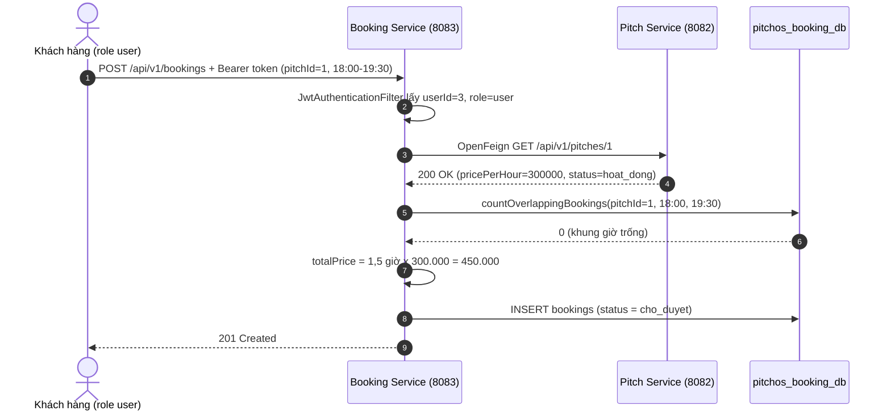
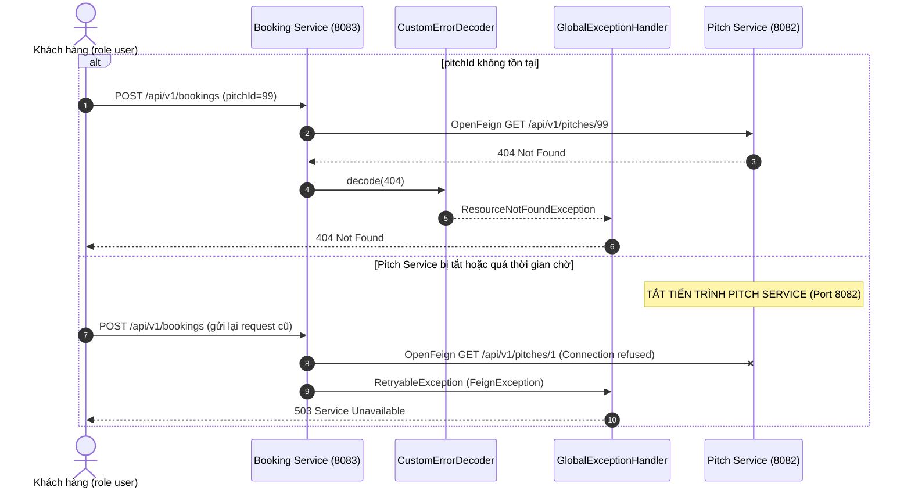

# Nhiệm vụ: Nhật — Giao tiếp Liên dịch vụ, Sequence Diagram & Booking Service

- **Vai trò:** Integration Specialist & Backend Booking Engineer
- **Tổng điểm phụ trách:** **2,25 / 10,0 Điểm** (0,75đ Lý thuyết + 1,5đ Thực nghiệm)
- **Cổng dịch vụ (Port):** `8083`
- **Cơ sở dữ liệu:** `pitchos_booking_db`
- **Báo cáo phụ trách:** **Chương 2** (Thiết kế API, giao tiếp liên dịch vụ, Sequence Diagram, cơ chế xử lý lỗi phân tán) — bản nháp nằm trong repository PTPM chung của nhóm (không đưa vào phần đóng góp này)
- **Thứ tự thực hiện:** **GIAI ĐOẠN 3** — Code sau khi Linh hoàn thiện `GET /api/v1/pitches/{id}` trên cổng 8082.

---

## 📚 1. Yêu cầu Lý thuyết (0,75 Điểm — Câu 1 Ý 2a)

- [x] **Quy trình giao tiếp HTTP/REST giữa Booking Service và Pitch Service:**
  - Booking Service đóng vai trò Client sử dụng OpenFeign gửi HTTP GET tra cứu thông tin sân sang Pitch Service (`GET /api/v1/pitches/{id}`).
  - Kiểm tra trạng thái sân (`hoat_dong`) và đơn giá thuê (`pricePerHour`) để tính tổng tiền.
- [x] **Phân tích cấu trúc HTTP Request / Response và ý nghĩa các nhóm HTTP Status Code:**
  - HTTP Request (Method, URI, Headers, Body), HTTP Response (Status Line, Headers, Body).
  - Các nhóm mã trạng thái:
    - `2xx` (Thành công: `200 OK`, `201 Created`).
    - `4xx` (Lỗi client: `400 Bad Request`, `401 Unauthorized`, `403 Forbidden`, `404 Not Found`).
    - `5xx` (Lỗi server: `500 Internal Server Error`, `503 Service Unavailable`).
- [x] **Nguy cơ sụp đổ dây chuyền (Cascading Failure):**
  - Hiện tượng thread pool bị nghẽn khi Pitch Service chậm hoặc sập.
  - Giải pháp timeout và chuyển đổi ngoại lệ mạng sang mã **503 Service Unavailable**.

---

## 🛠️ 2. Yêu cầu Thực nghiệm (1,5 Điểm — Câu 2 Ý 2)

### 2.1. Xây dựng nghiệp vụ chính tại Booking Service (Port 8083)
- [x] **Thực thể `Booking` & `BookingRepository`:**
  - Lưu `userId`, `pitchId` (dạng `Long`, không tạo khóa ngoại Foreign Key vật lý).
  - Áp dụng truy vấn chống trùng lịch thi đấu từ Hùng (`startTime < :endTime AND endTime > :startTime`, loại trừ đơn có trạng thái `tu_choi`).
- [x] **Các Endpoints chính:**
  - `POST /api/v1/bookings`: Tiếp nhận yêu cầu đặt sân, gọi sang Pitch Service lấy giá, kiểm tra khung giờ trống, tính tổng tiền, tạo đơn với trạng thái `cho_duyet`.
  - `GET /api/v1/bookings/my-bookings`: Truy vấn lịch sử đặt chỗ của khách hàng trích xuất từ Token JWT (role `user`).
  - `PATCH /api/v1/bookings/{id}/status`: Chủ sân duyệt đơn (`da_duyet`) hoặc từ chối (`tu_choi`) (role `chusan` hoặc `admin`).

### 2.2. Giao tiếp liên dịch vụ với Spring Cloud OpenFeign
> Hiện tại OpenFeign vẫn được giữ nguyên nhưng **không còn là mặc định**: mặc định dùng WebClient (TH2). Bật OpenFeign bằng `PITCH_CLIENT_TYPE=feign` (xem mục 7.2).
- [x] Kích hoạt `@EnableFeignClients` (trên `PitchosBookingServiceApplication`).
- [x] Định nghĩa Client interface gọi sang Pitch Service (`client/PitchClient.java`):
  ```java
  @FeignClient(name = "pitch-service", url = "${pitch.service.url:http://localhost:8082}")
  public interface PitchClient {
      @GetMapping("/api/v1/pitches/{id}")
      PitchResponseDTO getPitchById(@PathVariable("id") Long id);
  }
  ```

### 2.3. Lập trình tầng xử lý lỗi liên dịch vụ phân tán
- [x] **Cấu hình `CustomErrorDecoder`:** Bắt mã `404 Not Found` từ Pitch Service khi khách truyền `pitchId` không tồn tại.
- [x] **Cấu hình `GlobalExceptionHandler` (`@RestControllerAdvice`):**
  - Bắt lỗi mất kết nối, timeout mạng khi Pitch Service bị ngắt (`FeignException`, `RetryableException`).
  - Chuyển đổi an toàn thành mã phản hồi **503 Service Unavailable**:
    ```json
    {
      "timestamp": "2026-10-26T21:00:00",
      "status": 503,
      "error": "Service Unavailable",
      "message": "Dịch vụ quản lý sân hiện không khả dụng. Vui lòng thử lại sau!"
    }
    ```

### 2.4. Vẽ sơ đồ tuần tự (Sequence Diagram)
- [x] Mô tả chi tiết luồng nghiệp vụ tạo đơn đặt chỗ và kịch bản bắt lỗi 503 khi Pitch Service bị tắt — xem mục 6 bên dưới.

---

## 📝 3. Viết Báo cáo: Soạn Chương 2
- [x] Thiết kế các API đặt sân và điều phối nghiệp vụ.
- [x] Giao tiếp liên dịch vụ qua OpenFeign và Sequence Diagram.
- [x] Cơ chế xử lý lỗi phân tán, phòng chống Cascading Failure (503 Service Unavailable).

---

## 🎥 4. Kịch bản Demo Hội đồng (10–15 Phút)
1. **Ca 1 (Thành công - 201 Created):**
   - Đặt sân thành công với token `user`, tạo đơn với trạng thái `cho_duyet`.
   - Console của Booking Service in dòng `Pitch Service trả về sân 1: giá 300000.00 /giờ, trạng thái hoat_dong` → chứng minh Booking đã gọi sang Pitch Service.
   - **Mặc định Booking gọi Pitch bằng WebClient** (`PITCH_CLIENT_TYPE=webclient`). Để trình diễn **OpenFeign** (`PitchClient` + `CustomErrorDecoder`), khởi động Booking với `PITCH_CLIENT_TYPE=feign` (đặt trong `.env` hoặc biến môi trường, ví dụ PowerShell: `$env:PITCH_CLIENT_TYPE="feign"; mvn spring-boot:run`). Cả hai chế độ đều trả `503` khi Pitch Service tắt.
2. **Ca 2 (Sập dịch vụ phân tán - 503 Service Unavailable):**
   - **Tắt tiến trình Pitch Service (Port 8082)**.
   - Gửi lại request đặt sân vào Booking Service (Port 8083).
   - Chứng minh Booking Service bắt lỗi an toàn và trả về mã chuẩn **503 Service Unavailable**.

> ⚠️ Khi demo, mỗi khung giờ của một sân chỉ đặt được một lần (đơn `tu_choi` và `da_huy` đã nhả khung giờ). Nếu chọn khung giờ đã có đơn sẽ nhận 400 "Khung giờ này đã có người đặt". Giờ bắt đầu phải ở tương lai, thời lượng 30 phút – 8 giờ. Request Postman thư mục 1 tự chọn ngày ngẫu nhiên năm 2027 nên tránh được trùng lịch.

**Postman:** import [`postman/PitchOS-Booking.postman_collection.json`](postman/PitchOS-Booking.postman_collection.json), mở thư mục *1. Demo hội đồng (Nhật)*:
1. Gửi *Bước 1* → `201` (ngày đặt chọn ngẫu nhiên trong năm 2027 nên tập dượt nhiều lần không bị trùng lịch).
2. Báo Hùng chạy `SELECT` kiểm chứng CSDL.
3. Tắt Pitch Service (Ctrl + C cửa sổ 8082), gửi *Bước 3* (cùng khung giờ với Bước 1) → `503`; gửi *Bước 3b* → `200` (Booking Service không sập theo).

Collection **không chứa token còn hiệu lực**: đặt biến `demoPassword` (mật khẩu tài khoản demo của Auth Service, không lưu vào repo) rồi chạy thư mục *0* để tự lấy token `user`/`chusan`/`admin` và token của một user khác.

### Tập dượt khi Pitch Service / Auth Service chưa xong

```bash
# Cửa sổ 1: Pitch Service GIẢ LẬP trên cổng 8082 (dữ liệu mẫu: sân 1 giá 300.000đ, sân 4 đang bảo trì)
java pitchos-booking-service/demo/MockPitchService.java
# Cửa sổ 2: Booking Service (cần .env có JWT_SECRET và thông tin MySQL, xem README gốc repository)
cd pitchos-booking-service && mvn spring-boot:run
```

Thư mục *2* của collection (17 request, chạy bằng Collection Runner khi Pitch Service BẬT) và thư mục *3* (khi Pitch Service TẮT) là bộ kiểm thử Bảng 2.2. Trước khi chụp ảnh minh chứng cho báo cáo, chạy lại với Pitch Service thật của Linh.

---

## ▶️ 5. Hướng dẫn chạy và đặc tả API

```bash
cd pitchos-booking-service
mvn spring-boot:run
```

- Cần MySQL 8 với CSDL riêng của Booking (mặc định `pitchos_booking_db`, đổi bằng `BOOKING_DB_NAME`):
  - CSDL mới: chỉ cần `CREATE DATABASE pitchos_booking_db CHARACTER SET utf8mb4 COLLATE utf8mb4_unicode_ci;`. Hibernate (`ddl-auto=update`) tự tạo bảng `bookings` và `pitch_locks`.
  - CSDL đã tạo từ script chung của nhóm: chạy [`db/V2__booking_th1_th7_mysql.sql`](db/V2__booking_th1_th7_mysql.sql) **trước** khi khởi động, chỉ định tên CSDL khi gọi lệnh: `mysql -u <user> -p --default-character-set=utf8mb4 <ten_csdl_booking> < db/V2__booking_th1_th7_mysql.sql` (không dùng `--force`). Script không cố định tên CSDL, **chạy lại an toàn**, kiểm tra cấu trúc trước khi sửa và dừng với mã lỗi `V2_LOI_…` nếu không tương thích; không xóa dữ liệu. Bắt buộc với CSDL của script chung: nếu ENUM `status` thiếu `da_huy`, hủy đơn trả 500.
  - Cả hai cách đã kiểm thử trên **MySQL 8.4.3** thử nghiệm (`../docs/bang-chung-kiem-thu/th4-mysql-8.4.3.txt`); **chưa** kiểm thử MySQL 8.0 và MySQL của nhóm.
- Cấu hình đặt trong `.env` theo mẫu `.env.example` ở gốc workspace (Booking tự đọc `./.env` hoặc `../.env`). `JWT_SECRET` **bắt buộc**, không có giá trị mặc định, phải trùng secret của Auth Service. `MYSQL_PASSWORD` mặc định rỗng.
- JDBC dùng `serverTimezone=Asia/Ho_Chi_Minh` để giờ đặt sân lưu xuống MySQL đúng như giờ gửi lên (dùng `UTC` sẽ lệch 7 tiếng).
- Timeout gọi Pitch Service: kết nối 2s, đọc 3s.
- Chống đặt trùng khi nhiều request **đồng thời**: khóa nằm **trong CSDL**, không nằm trong bộ nhớ.
  - Mỗi sân có một dòng trong bảng `pitch_locks` (do `PitchLockService` tạo).
  - `BookingWriter` mở transaction `READ_COMMITTED` và khóa dòng đó bằng `SELECT … FOR UPDATE` (`PitchLockRepository.lockByPitchId`). Sau đó mới kiểm tra trùng lịch và lưu đơn. Vì vậy các request cùng sân lần lượt chạy "kiểm tra → lưu", **kể cả khi có nhiều instance Booking dùng chung CSDL**.
  - Lời gọi Pitch Service nằm ngoài transaction.
  - Kiểm chứng: 10 request đồng thời vào cùng 1 khung giờ → đúng 1 đơn `201`, 9 request `400` (`Th6IdempotencyConcurrencyIntegrationTest`, đạt trên cả H2 và MySQL 8.4.3). Trên MySQL 8.4.3 với **2 instance Booking dùng chung CSDL**: 20 request đồng thời cùng khung giờ → đúng 1 đơn; request phải chờ khi một phiên khác giữ `FOR UPDATE` trên dòng khóa của sân.

| Method | URL | Role | Body | Thành công |
| :--- | :--- | :---: | :--- | :---: |
| `POST` | `/api/v1/bookings` | `user` | `{"pitchId":1,"startTime":"2027-01-15T18:00:00","endTime":"2027-01-15T19:30:00"}` | `201` |
| `GET` | `/api/v1/bookings/my-bookings` | `user` | — | `200` |
| `PATCH` | `/api/v1/bookings/{id}/status` | `chusan` (chỉ khi Pitch trả `ownerId` trùng), `admin` | `{"status":"da_duyet"}` hoặc `{"status":"tu_choi"}` | `200` |

| Mã lỗi | Khi nào |
| :---: | :--- |
| `400` | Thiếu trường, `endTime` không sau `startTime`, sân đang bảo trì, trùng lịch, `status` sai, đổi trạng thái đơn đã `tu_choi` |
| `401` | Không gửi token, token sai chữ ký, hết hạn, thiếu `role`, hoặc thiếu `userId` (khi `sub` không phải số) |
| `403` | Sai vai trò (token `chusan` gọi `POST`, token `user` gọi `PATCH`, role không thuộc `user`/`chusan`/`admin`); chủ sân chưa xác minh được quyền sở hữu sân (fail-closed) |
| `404` | `pitchId` không tồn tại trên Pitch Service, hoặc đơn đặt không tồn tại |
| `503` | Pitch Service bị tắt / quá thời gian chờ / trả lỗi |

**Cấu trúc mã nguồn:**

```text
src/main/java/com/pitchos/booking/
├── PitchosBookingServiceApplication.java   # @EnableFeignClients
├── client/      PitchClient, CustomErrorDecoder
├── controller/  BookingController
├── dto/         BookingRequest, BookingResponse, UpdateStatusRequest, PitchResponseDTO, ErrorResponse
├── entity/      Booking, BookingStatus (Hùng)
├── exception/   GlobalExceptionHandler, BadRequestException, ResourceNotFoundException
├── repository/  BookingRepository (Hùng)
├── security/    JwtUtil, JwtAuthenticationFilter, SecurityConfig
└── service/     BookingService

demo/MockPitchService.java                  # Pitch Service giả lập để tập dượt (không thuộc mã nguồn service)
postman/PitchOS-Booking.postman_collection.json
```

**Hợp đồng với nhóm:**
- **Linh:** `GET /api/v1/pitches/{id}` trả JSON có `id`, `name`, `pricePerHour`, `status`; trả `404` khi không có sân.
- **Hoàng:** token ký HS256 bằng `Keys.hmacShaKeyFor(Decoders.BASE64.decode(jwt.secret))`, có claim `role` (`admin`/`chusan`/`user`) và `userId` (nếu không có thì `sub` phải là id số).

---

## 🧭 6. Sequence Diagram

### 6.1. Đặt sân thành công (201 Created)



### 6.2. Lỗi phân tán: sân không tồn tại (404) và Pitch Service bị tắt (503)



> **Vì sao gọi Pitch Service trước rồi mới kiểm tra trùng lịch?** Ở bước demo 503, nhóm gửi lại đúng request vừa đặt thành công. Nếu kiểm tra trùng lịch trước, request bị chặn bằng lỗi "trùng lịch" mà không gọi sang Pitch Service, nên không thể chứng minh được 503.

---

## 🧩 7. Bổ sung TH1–TH7 (11/2026)

> Giữ nguyên toàn bộ phần trên. Chi tiết và bằng chứng kiểm thử: [`docs/BAO_CAO_HOAN_THANH_NHAT_TH1_TH7.md`](../docs/BAO_CAO_HOAN_THANH_NHAT_TH1_TH7.md).

### 7.1. API

| Method | Endpoint | Quyền | Ghi chú |
|---|---|---|---|
| POST | `/api/v1/bookings` | user | (cũ) 201 + `Location`. Header tùy chọn `Idempotency-Key`: gửi lại → 200 + `Idempotent-Replayed: true`; cùng key khác nội dung → 409 |
| GET | `/api/v1/bookings/my-bookings` | user | (cũ) danh sách, không phân trang |
| PATCH | `/api/v1/bookings/{id}/status` | chusan (Pitch trả `ownerId` trùng), admin | (cũ) `da_duyet` / `tu_choi`. Pitch chưa có `ownerId` hoặc lỗi → chủ sân 403/503 |
| GET | `/api/v1/bookings` | user (chỉ đơn của mình), admin; **chusan 403** (chờ Pitch có API sân theo chủ sở hữu) | phân trang `page`, `size` (≤ 100), `sort=truong,asc\|desc`; lọc `status`, `pitchId`, `userId` (chỉ admin/chusan), `date` hoặc `from`/`to` |
| GET | `/api/v1/bookings/{id}` | chủ đơn, chusan (Pitch trả `ownerId` trùng), admin | user xem đơn người khác → 403 |
| PUT | `/api/v1/bookings/{id}` | user (chủ đơn) | chỉ đơn `cho_duyet`; tính lại giá từ Pitch Service |
| PATCH | `/api/v1/bookings/{id}/cancel` | user (chủ đơn), admin | hủy mềm → `da_huy`, giữ lịch sử |
| DELETE | `/api/v1/bookings/{id}` | user (chủ đơn), admin | như `/cancel`, trả 204 |
| GET | `/api/v1/bookings/quote?pitchId&startTime&endTime` | đã đăng nhập | báo giá, không tạo đơn |

Quy tắc giờ: `startTime` ở tương lai, `endTime > startTime`, thời lượng 30 phút – 8 giờ.

### 7.2. Cấu hình mới (biến môi trường)

| Biến | Mặc định | Ý nghĩa |
|---|---|---|
| `PITCH_CLIENT_TYPE` | `webclient` | `feign` để dùng lại OpenFeign cũ |
| `PITCH_DISCOVERY_ENABLED` | `false` | `true`: gọi Pitch theo tên `pitchos-pitch-service` qua LoadBalancer |
| `EUREKA_ENABLED` / `EUREKA_URL` | `false` / `http://localhost:8761/eureka/` | đăng ký Booking vào Eureka |
| `PITCH_RESPONSE_TIMEOUT_MS`, `PITCH_MAX_RETRIES` | `3000`, `2` | timeout và số lần thử lại (chỉ lỗi tạm thời) |
| `BOOKING_CHUSAN_WITHOUT_OWNER_INFO` | `false` | Fail-closed: chủ sân chỉ được thao tác khi Pitch trả `ownerId` trùng. `true` = **chế độ tương thích KHÔNG AN TOÀN**, chỉ để demo cục bộ với Pitch cũ / giả lập, **không** dùng trong tích hợp thật |
| `JWT_SECRET` | **không có (bắt buộc)** | phải trùng secret của Auth Service; thiếu thì ứng dụng dừng khi khởi động |
| `MYSQL_PASSWORD` | rỗng | mật khẩu MySQL, đặt trong `.env` (không commit) |

### 7.3. Chạy

Hướng dẫn đầy đủ (cấu hình `.env`, MySQL, Auth, Pitch, Eureka): xem `README.md` ở gốc repository.

```bash
# Test tự động (H2, Pitch giả lập bằng HTTP server thật trong JDK) - không cần MySQL, Auth, Pitch
mvn test

# CSDL đã tạo từ script chung của nhóm: nâng cấp TRƯỚC khi chạy bản mới (chạy lại an toàn; tự chỉ định tên CSDL)
mysql -u <user> -p --default-character-set=utf8mb4 <ten_csdl_booking> < db/V2__booking_th1_th7_mysql.sql

# Chạy thường (MySQL + Pitch Service ở 8082; biến lấy từ ../.env)
mvn spring-boot:run

# Chạy với Eureka (cần Eureka Server ở 8761 và Pitch Service đã đăng ký)
EUREKA_ENABLED=true PITCH_DISCOVERY_ENABLED=true mvn spring-boot:run
```
